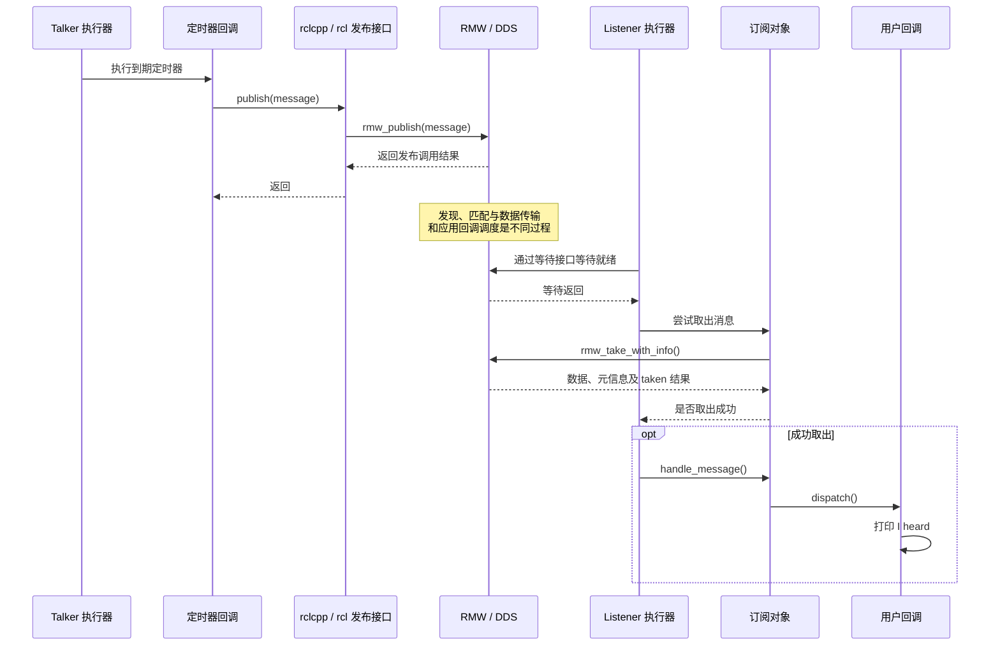

# 第 2 章 从 talker/listener 追踪一条消息

当我们在两个终端中分别启动 talker 和 listener，屏幕上很快就会出现两组熟悉的日志：一端打印 `Publishing`，另一端打印 `I heard`。对应用开发者而言，几行代码便完成了通信；对源码阅读者而言，这几行代码恰好是一扇入口。

调用 `publish()` 后，消息究竟去了哪里？订阅回调是谁调用的？创建一个定时器，是否就意味着某个线程会每秒自动执行它？本章沿着一个字符串的旅程，建立通信和执行的整体认识。后续章节再展开每个对象的创建细节与内部数据结构。

本章以当前 `ros2_humble` 目录的源码为基线。分析范围是两个独立进程、普通类型消息的发布与接收；具体中间件的发送入口以工作区中的 `rmw_fastrtps_cpp` 为例。这是源码核验后的试写稿，实验步骤尚未在本工作区运行，日志示意不作为实测记录。

## 2.1 两个节点，一条话题

首先打开两个文件：

- [`talker.cpp`](../../src/ros2/demos/demo_nodes_cpp/src/topics/talker.cpp)
- [`listener.cpp`](../../src/ros2/demos/demo_nodes_cpp/src/topics/listener.cpp)

它们都位于 `demo_nodes_cpp` 包中。Talker 和 Listener 分别继承 `rclcpp::Node`，构造时指定节点名 `talker` 和 `listener`。节点名用于标识节点；连接发布者与订阅者的是话题以及通信端点的相关配置。

Talker 的关键配置如下。以下代码节选自其构造函数：

```cpp
rclcpp::QoS qos(rclcpp::KeepLast{7});
pub_ = this->create_publisher<std_msgs::msg::String>("chatter", qos);
timer_ = this->create_wall_timer(1s, publish_message);
```

第一行构造 QoS 配置，选择保留最近若干样本的历史策略，深度设为 7。第二行创建一个发布者，其消息类型是 `std_msgs::msg::String`，话题名是 `chatter`。第三行创建周期为一秒的墙上时钟定时器，并保存其共享指针。

这里的“一秒”是定时器周期配置，不是对回调实际执行间隔的严格保证。回调能否及时运行，还要看执行器是否在处理工作，以及线程是否被其他回调占用。

Listener 则把接收后的处理逻辑交给订阅者：

```cpp
auto callback =
  [this](std_msgs::msg::String::ConstSharedPtr msg) -> void
  {
    RCLCPP_INFO(this->get_logger(), "I heard: [%s]", msg->data.c_str());
  };
sub_ = create_subscription<std_msgs::msg::String>("chatter", 10, callback);
```

这段代码来自 `listener.cpp`。回调参数是指向常量消息的共享指针，回调读取其中的 `data` 并打印。创建订阅时传入的 `10` 用于构造历史深度配置；它不是要接收十条消息后才触发回调。

发送端深度是 7，接收端深度是 10，两者并不需要数值完全相同才能通信。QoS 是否兼容需要按具体策略判断，不能只比较深度。话题名和消息类型相同也是必要检查项，但仅凭它们不足以保证建立通信。

## 2.2 字符串消息从哪里来

Talker 包含了一个头文件：

```cpp
#include "std_msgs/msg/string.hpp"
```

阅读源码树时，不一定能够直接找到这个生成后的文件。它的原始输入是 [`String.msg`](../../src/ros2/common_interfaces/std_msgs/msg/String.msg)，有效字段定义只有一行：

```text
string data
```

接口生成工具把这份定义转换为各语言使用的数据类型和相关支持代码。对于本章，先记住两件事：`std_msgs::msg::String` 是应用侧的 C++ 消息类型；底层通信还需要类型支持，才能处理这种消息的数据表示与序列化。

`String.msg` 的本地注释还说明，这个通用字符串消息原本用于示例，实际应用应优先使用具有明确业务语义的消息定义。本章保留它，是为了让注意力集中在通信过程上。

## 2.3 没有 main()，程序如何启动

两个节点文件末尾分别出现组件注册宏：

```cpp
RCLCPP_COMPONENTS_REGISTER_NODE(demo_nodes_cpp::Talker)
```

Listener 使用相同形式注册自己的类。但文件中没有 `main()`。要找到执行入口，需要把节点源码和构建规则连起来阅读。

[`demo_nodes_cpp/CMakeLists.txt`](../../src/ros2/demos/demo_nodes_cpp/CMakeLists.txt) 把相关源码编译到 `topics_library`，再通过 `rclcpp_components_register_node` 指定组件类及可执行文件名，例如 `talker` 和 `listener`。

这一构建宏使用 [`node_main.cpp.in`](../../src/ros2/rclcpp/rclcpp_components/src/node_main.cpp.in) 生成可执行文件的入口。模板中的流程可以概括为：

```text
初始化 ROS 上下文并处理参数
  → 创建执行器与 NodeOptions
  → 加载组件库
  → 通过节点工厂创建节点实例
  → exec.add_node(node)
  → exec.spin()
  → 移除节点并关闭 ROS
```

[`rclcpp_components_register_node.cmake`](../../src/ros2/rclcpp/rclcpp_components/cmake/rclcpp_components_register_node.cmake) 在没有另外指定执行器时选择 `SingleThreadedExecutor`。`NodeOptions` 的本地定义则把进程内通信选项默认设为 `false`。

因此，在分别启动这两个示例可执行文件的条件下，可以沿普通中间件通信路径阅读。若把节点加载到组件容器并启用进程内通信，路径会发生变化，不能直接照搬本章的全部结论。

## 2.4 第一段旅程：定时器触发发布

Talker 在构造函数里定义了 `publish_message`。它每次被执行时，创建一条新消息、填入字符串、打印日志，然后发布：

```cpp
msg_ = std::make_unique<std_msgs::msg::String>();
msg_->data = "Hello World: " + std::to_string(count_++);
RCLCPP_INFO(this->get_logger(), "Publishing: '%s'", msg_->data.c_str());
pub_->publish(std::move(msg_));
```

这些语句节选自 `talker.cpp`。计数器初始值为 1，因此第一次构造的文本是 `Hello World: 1`。

需要特别留意日志的位置：它在 `publish()` 之前。看到 `Publishing`，只能确定程序执行到了这条日志，不能据此证明后续发布成功，更不能证明 Listener 已收到消息。

另一个容易忽略的细节是 `std::move(msg_)`。这里选择接收 `unique_ptr` 的发布重载，把消息所有权交给 `rclcpp`；调用后，不能再通过这个成员指针读取刚才的消息。下一次定时器回调会重新创建消息。

不过，所有权转移不等于整条通信链都没有复制。它为某些进程内优化提供了条件，但本章讨论的独立进程通信仍要进入中间件路径，复制和序列化行为取决于后续实现。

是谁调用了 `publish_message`？答案在执行器中。`Executor::execute_any_executable()` 对可执行对象进行分类，定时器对象进入 `execute_timer()`。因此，定时器到期与回调开始执行是两个不同的时刻。创建定时器是登记工作；执行器运行，才会持续处理这些工作。

## 2.5 publish() 如何穿过三层接口

在 [`publisher.hpp`](../../src/ros2/rclcpp/rclcpp/include/rclcpp/publisher.hpp) 中，接收 `unique_ptr` 的重载首先检查进程内通信是否启用。其普通路径是：

```cpp
if (!intra_process_is_enabled_) {
  this->do_inter_process_publish(*msg);
  return;
}
```

接着，`do_inter_process_publish()` 调用 `rcl_publish()`，并根据返回值处理错误。发送路径由此进入公共 C 接口层。

[`rcl/publisher.c`](../../src/ros2/rcl/rcl/src/rcl/publisher.c) 中的 `rcl_publish()` 校验发布者和消息参数，再通过发布者内部保存的 RMW 句柄调用 `rmw_publish()`。对应用而言，使用的仍是同一个 C++ 发布接口；到 RMW 这一层，具体通信实现才接手消息。

把三个入口放在一起，可以看出分层关系：

```text
Talker 的定时器回调
  → Publisher::publish(unique_ptr)
  → Publisher::do_inter_process_publish()
  → rcl_publish()
  → rmw_publish()
  → 具体 RMW 实现
```

`rclcpp` 提供 C++ 对象、模板和所有权接口；`rcl` 提供客户端库共用的 C 层操作；RMW 提供面向通信中间件的抽象接口。这里展示的是调用关系，并不是说每层都有一条独立线程或者一份独立消息队列。

如果选用 `rmw_fastrtps_cpp`，其 [`rmw_publish.cpp`](../../src/ros2/rmw_fastrtps/rmw_fastrtps_cpp/src/rmw_publish.cpp) 将调用转交给共享实现 `__rmw_publish()`。

在 [`rmw_fastrtps_shared_cpp/src/rmw_publish.cpp`](../../src/ros2/rmw_fastrtps/rmw_fastrtps_shared_cpp/src/rmw_publish.cpp) 中，这个函数从发布者内部取得 `CustomPublisherInfo`，把消息指针与类型支持信息封装为 `SerializedData`，随后调用：

```cpp
info->data_writer_->write(&data)
```

这就是本章追踪到的 Fast DDS 写入入口。封装结构名叫 `SerializedData`，并不意味着此处已经得到最终字节流；本段源码把 `is_cdr_buffer` 设为 `false`，并携带原始 ROS 消息指针与类型支持信息。具体序列化过程还要继续阅读类型支持和 DDS 实现。

走到这里，发布端的调用已经进入中间件。接收端何时发现数据、何时处理回调，则是另一段过程。`publish()` 返回也不能被解释为“远端用户回调已经执行完毕”。同样，仅凭示例中关于非阻塞的注释，不能对所有 QoS 和中间件配置下的调用耗时作保证。

## 2.6 第二段旅程：数据就绪后，执行器取出消息

Listener 的构造函数只创建订阅并注册回调，没有持续接收的循环。这个循环位于 [`single_threaded_executor.cpp`](../../src/ros2/rclcpp/rclcpp/src/rclcpp/executors/single_threaded_executor.cpp) 的 `spin()` 中：

```cpp
while (rclcpp::ok(this->context_) && spinning.load()) {
  rclcpp::AnyExecutable any_executable;
  if (get_next_executable(any_executable)) {
    execute_any_executable(any_executable);
  }
}
```

循环先寻找可执行工作，再执行它。当没有现成工作时，`get_next_executable()` 可以进入等待过程。[`executor.cpp`](../../src/ros2/rclcpp/rclcpp/src/rclcpp/executor.cpp) 中的 `wait_for_work()` 组织等待集合，并调用 `rcl_wait()` 等待就绪事件。

这个过程把“底层有数据可读”和“应用函数被调用”连接起来。对于本章的单线程执行器，用户订阅回调由执行器线程执行；底层中间件收到数据并不意味着它直接在自己的接收线程上调用这个 lambda。

当执行器选中了订阅对象，`execute_any_executable()` 转入 `execute_subscription()`。后者有多个分支：序列化消息、借用消息，以及普通类型消息。下面只看非序列化且不能借用消息时的普通分支：

```text
创建或借出一份接收消息对象
  → take_type_erased() 尝试取出数据
  → 成功时调用 handle_message()
  → 将消息对象交还给消息内存策略
```

`take_type_erased()` 定义在 [`subscription_base.cpp`](../../src/ros2/rclcpp/rclcpp/src/rclcpp/subscription_base.cpp)，它调用 `rcl_take()`。这里的“类型擦除”意味着该公共入口使用 `void *` 接收目标对象地址，并不表示通信不需要消息类型信息。具体消息类型与类型支持已在其他对象和创建过程中确定。

再进入 [`rcl/subscription.c`](../../src/ros2/rcl/rcl/src/rcl/subscription.c)，可以看到 `rcl_take()` 调用的是 `rmw_take_with_info()`。除了取出消息数据，它还取得消息相关元信息。

需要区分“等待返回”和“成功取到消息”。RMW 接口通过 `taken` 表示这次是否实际取出了样本；如果没有，`rcl_take()` 返回 `RCL_RET_SUBSCRIPTION_TAKE_FAILED`，上层将其转换为 `false`。执行器的 `take_and_do_error_handling()` 只有在取出成功时才调用处理函数。源码注释也明确指出，等待可能出现没有取到数据的唤醒。

因此，不能把等待集合中的就绪状态当成一个不可失败的接收承诺。执行器仍要尝试取出，并处理结果。

## 2.7 最后一步：进入用户回调

普通消息取出成功后，执行器调用订阅对象的 `handle_message()`。在 [`subscription.hpp`](../../src/ros2/rclcpp/rclcpp/include/rclcpp/subscription.hpp) 中，它把通用消息指针转换为具体消息类型，然后进入：

```cpp
any_callback_.dispatch(typed_message, message_info);
```

订阅创建时注册的用户回调由这套回调分发机制调用。至此，Listener 构造函数里的 lambda 才开始执行，打印消息中的字符串。

把普通接收路径列出来，便能与发送路径对照：

```text
SingleThreadedExecutor::spin()
  → get_next_executable()
  → execute_any_executable()
  → execute_subscription()
  → SubscriptionBase::take_type_erased()
  → rcl_take()
  → rmw_take_with_info()
  ← 返回取出结果与消息数据
  → Subscription::handle_message()
  → any_callback_.dispatch()
  → Listener 的用户回调
```

箭头在 `rmw_take_with_info()` 处返回，是为了强调：先取出，再分发。用户回调不是 `rcl_take()` 内部直接执行的。

## 2.8 把整段旅程画在一起

下图描述本章选择的路径。它把底层传输抽象为一个阶段，不指定数据一定走网络；同机进程间通信的具体传输机制还取决于中间件配置。



图中的阶段没有给出跨线程的精确时序保证。实际运行时，远端取出消息与本地发布调用返回之间的先后关系可能受实现和调度影响；不能把示意图当成延迟测量结果。

## 2.9 用三个实验检验理解

以下实验尚未执行。前提是已经构建并加载包含上述源码的 ROS 环境；若使用其他安装环境，观察结果只能验证那个环境的行为。两个终端需要使用相同的 ROS domain，并具有可兼容的发现与通信配置。

### 实验一：建立基本通信

在两个终端中分别运行：

```text
ros2 run demo_nodes_cpp talker
ros2 run demo_nodes_cpp listener
```

预期现象是发送端持续打印递增字符串，接收端在发现并匹配完成后打印收到的字符串。接收端不一定从编号 1 开始，也不能仅通过肉眼观察断言所有消息都完整到达。

可以在第三个终端查看端点信息：

```text
ros2 topic info /chatter --verbose
```

在默认命名空间且没有重映射时，示例中的相对话题名 `chatter` 对应 `/chatter`。记录端点类型、QoS 和节点信息，再与构造函数配置对照。命令查询只提供观察线索，并不单独证明整条调用链。

### 实验二：暂停 Listener 的执行器

使用调试器在 Listener 的 `exec.spin()` 前暂停，保持 Talker 运行，然后继续执行 Listener。

预期在 Listener 暂停期间，它的用户订阅回调不会运行，因为执行器尚未进入调度循环。恢复后是否还能取出暂停期间的消息、能取出多少，取决于发现时机、历史缓存和其他配置；需要记录实际结果。

这个实验检验的是应用回调对执行器的依赖。它不表示暂停期间底层通信线程一定停止工作。

### 实验三：沿调用栈确认发布与接收

在具有调试符号的构建中设置断点：

| 进程 | 建议断点 | 观察目标 |
| --- | --- | --- |
| Talker | `rcl_publish` | 确认定时器回调经发布接口进入 C 层 |
| Talker | `rmw_fastrtps_shared_cpp::__rmw_publish` | 仅在选用对应 RMW 时观察 DDS 写入入口 |
| Listener | `rcl_take` | 确认由执行器发起消息取出 |
| Listener | `Subscription::handle_message` 或用户 lambda | 对照成功取出后的回调调用栈 |

模板函数与优化构建可能让断点定位不直观，可按文件和语句位置设置。暂停进程会改变时序和缓存状态，这个实验用于验证调用关系，不用于测量性能。

## 2.10 本章小结

一条字符串消息跨越了两段相互协作的流程。Talker 的执行器调度定时器，定时器回调创建消息，并通过 `rclcpp → rcl → rmw` 进入中间件。Listener 的执行器等待事件、尝试取出消息，并在成功后通过订阅对象分发到用户回调。

这条路径也给出了阅读后续源码时的三个锚点：消息如何表示与传输，事件如何等待与调度，对象及其内存由谁持有。节点、发布者和订阅者的创建过程决定了这些对象如何连接；执行器则决定已就绪的工作何时成为应用行为。

下一章将围绕这些对象梳理框架分层与资源生命周期，再回到创建过程，解释本章调用链中的句柄、类型支持和上下文从何而来。

## 源码索引与核验范围

以上链接均指向当前工作区源码；分析没有以外部版本替换本地实现。代码块为必要节选，版权与许可证以原文件为准。

| 主题 | 主要源码入口 |
| --- | --- |
| 示例和构建 | `demos/demo_nodes_cpp/src/topics/{talker,listener}.cpp`；`demo_nodes_cpp/CMakeLists.txt` |
| 组件入口 | `rclcpp_components/src/node_main.cpp.in`；`cmake/rclcpp_components_register_node.cmake` |
| 发布 | `rclcpp/include/rclcpp/publisher.hpp`；`rcl/src/rcl/publisher.c` |
| Fast DDS 写入入口 | `rmw_fastrtps_cpp/src/rmw_publish.cpp`；`rmw_fastrtps_shared_cpp/src/rmw_publish.cpp` |
| 调度与接收 | `rclcpp/src/rclcpp/executors/single_threaded_executor.cpp`；`executor.cpp`；`subscription_base.cpp` |
| 取出与回调 | `rcl/src/rcl/subscription.c`；`rclcpp/include/rclcpp/subscription.hpp` |

上述路径相对于各自所属仓库或包，完整路径可通过正文链接定位。已核验示例配置、组件入口、普通发布与取出调用、执行器分支及回调分发；尚未运行实验，也未在本章展开 DDS 发现、序列化内部实现、借用消息和进程内通信。
