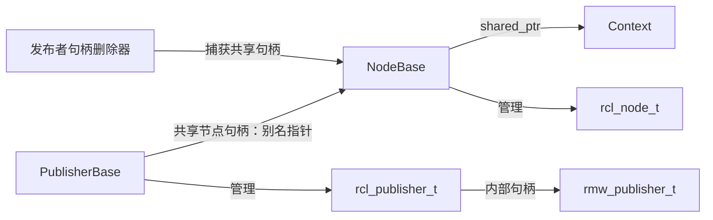

# 第 3 章 ROS 2 分层与资源生命周期

上一章沿着一条消息经过了 `rclcpp → rcl → rmw`，也看到了执行器如何把可读数据交给订阅回调。但这条调用链留下了一组问题：`rcl_publish()` 接收的句柄从哪里来？为什么发布函数没有再次传入消息类型？程序结束时，谁负责销毁这些对象？

本章转向对象的创建与释放，把通信路径背后的结构补齐。阅读结束后，应当能够解释节点、上下文、端点和执行器之间的关系，并区分对象的存活、运行状态和资源清理。

本章继续以当前 `ros2_humble` 目录及项目的 `sources.repos` 为源码基线。关键结论来自本地源码检查；文末实验尚未运行。这里的“资源生命周期”指普通节点和通信对象的创建、持有与释放，不是后续章节将讨论的 LifecycleNode 状态机。

## 3.1 分层首先是职责分工

从应用视角看，创建一个发布者只需要节点、话题、消息类型和 QoS。然而，底层实现还要处理名称解析、类型支持、通信端点创建和错误传播。ROS 2 把这些工作分配到不同层次。

| 层次 | 本章关注的职责 | 典型入口 |
| --- | --- | --- |
| rclcpp | C++ 对象、模板接口、回调与资源管理 | `Node`、`Publisher`、`Subscription`、`Context` |
| rcl | 公共 C 接口、句柄及相关校验 | `rcl_node_init`、`rcl_publisher_init` |
| rmw | 通信实现需要满足的抽象接口 | `rmw_create_node`、`rmw_create_publisher` |
| 具体 RMW 与 DDS | 具体通信实体、发现和数据交换 | 实现相关对象和接口 |

这张表表示职责和调用方向，不表示每层都有独立进程、线程或一份完整消息副本。应用中的一个 `Publisher` 会关联到底层句柄，但不能仅凭名字推断它与 DDS 对象必然一一对应。底层实体如何共享，需要检查具体 RMW 实现。

还要把执行器放在正确位置。执行器是调度机制，负责等待和处理回调工作；它不是 `rcl` 与 `rmw` 之间的另一层通信协议。创建发布者和调用 `publish()` 可以发生在执行器循环之外，而示例里的定时器和订阅回调依赖执行器来运行。

## 3.2 Context：对象存在之前，先建立运行上下文

在上一章的程序入口里，初始化先于节点创建。相关 C++ 实现集中在 [`context.cpp`](../../src/ros2/rclcpp/rclcpp/src/rclcpp/context.cpp)。

`Context::init()` 分配一个 `rcl_context_t`，使用 `rcl_get_zero_initialized_context()` 设置初始状态，再调用 `rcl_init()`。后者在 [`rcl/init.c`](../../src/ros2/rcl/rcl/src/rcl/init.c) 中进一步调用 `rmw_init()`。

```text
Context::init()
  → 建立零初始化的 rcl_context_t
  → rcl_init()
  → rmw_init()
```

这里的“零初始化”不等于“已经可以通信”。它为后续初始化提供一个合法起点；初始化成功后，上下文才进入可用状态。阅读 C 层资源时，应把分配内存、零初始化和实际初始化当成不同步骤。

Context 不是机器人业务节点。它为一组 ROS 对象提供共同的运行上下文，并管理初始化、关闭及相关通知。`Node` 构造时从 `NodeOptions` 获取 Context，`NodeBase` 则保存它的共享指针。因此，节点并非只记住一个全局布尔值，而是关联到一个具体上下文对象。

常见程序使用默认上下文，但源码接口也允许显式传入 Context。分析 `ok()` 或 `shutdown()` 的影响时，要先确认它们作用于哪个上下文，不能不加条件地认为关闭操作总会影响进程内的所有 ROS 对象。

## 3.3 Node：一个应用接口，多个职责对象

打开 [`node.cpp`](../../src/ros2/rclcpp/rclcpp/src/rclcpp/node.cpp) 的构造函数，会发现 `Node` 内部创建了一组对象，而不是把所有功能放在同一个实现里。

其中包括：

- `NodeBase`：基础节点句柄、上下文和回调组等能力。
- `NodeTopics`：发布与订阅的创建和登记。
- `NodeTimers`、`NodeServices`：定时器及服务相关接口。
- `NodeGraph`、`NodeLogging`：图信息和日志接口。
- `NodeClock`、`NodeParameters`、`NodeTimeSource`：时钟、参数和时间源相关能力。
- `NodeWaitables`：其他可等待工作的登记接口。

这种拆分在源码阅读中很有用。例如，`Node::create_publisher()` 是用户入口，但真正创建和登记话题端点的工作会继续进入话题接口。若只停留在 `Node` 的定义里，很容易把转发函数误认为实现已经结束。

它也说明，一个“没有显式创建业务发布者”的节点并不一定没有任何通信端点。参数服务、参数事件以及日志等功能可能在节点初始化过程中建立，具体取决于选项。调试时看到额外的创建调用，应先检查其用途。

### NodeBase 如何创建 C 层节点

[`node_base.cpp`](../../src/ros2/rclcpp/rclcpp/src/rclcpp/node_interfaces/node_base.cpp) 给出了最直接的连接点。构造函数创建零初始化的 `rcl_node_t`，再将名称、命名空间、上下文和节点选项交给 `rcl_node_init()`。

[`rcl/node.c`](../../src/ros2/rcl/rcl/src/rcl/node.c) 内部进一步调用 `rmw_create_node()`。成功后的节点句柄由 `NodeBase` 保存，并配置了自定义删除器：释放时先执行 `rcl_node_fini()`，再删除承载句柄的 C++ 堆对象。

```text
Node 构造
  → NodeBase 构造
  → rcl_node_init()
  → rmw_create_node()

节点句柄最终释放
  → 自定义删除器
  → rcl_node_fini()
  → rmw_destroy_node()
  → 删除句柄对象
```

这条路径中，`fini` 清理已经初始化的内部资源，`delete` 释放承载句柄的内存。两者承担的工作不同；只删除外层结构不能代替底层资源清理。

## 3.4 Publisher：消息类型在创建时进入底层

上一章的 Talker 调用了：

```cpp
pub_ = this->create_publisher<std_msgs::msg::String>("chatter", qos);
```

这一行同时包含编译期和运行期信息。模板参数给出 C++ 消息类型，字符串给出话题名，QoS 对象给出端点策略。要找到它们如何交汇，可以阅读 [`create_publisher.hpp`](../../src/ros2/rclcpp/rclcpp/include/rclcpp/create_publisher.hpp)。

其中的创建流程先取得节点话题接口，再通过类型相关的工厂创建发布者，随后调用 `add_publisher()` 完成相关登记与通知，最后返回发布者共享指针。若启用了 QoS 参数覆盖选项，实际 QoS 还可能在创建前经过参数处理。

[`node_topics.cpp`](../../src/ros2/rclcpp/rclcpp/src/rclcpp/node_interfaces/node_topics.cpp) 中的 `NodeTopics::create_publisher()` 使用工厂构造具体类型的发布者。`Publisher<MessageT>` 的构造过程把类型支持传给基类 `PublisherBase`。

```text
create_publisher<MessageT>()
  → 创建类型相关工厂
  → NodeTopics::create_publisher()
  → Publisher<MessageT> / PublisherBase 构造
  → rcl_publisher_init()
  → rmw_create_publisher()
```

### 类型支持与消息对象有什么区别

在 [`publisher.hpp`](../../src/ros2/rclcpp/rclcpp/include/rclcpp/publisher.hpp) 中，构造函数使用 `get_message_type_support_handle<MessageT>()` 取得类型支持。对于普通 ROS 消息，[`get_message_type_support_handle.hpp`](../../src/ros2/rclcpp/rclcpp/include/rclcpp/get_message_type_support_handle.hpp) 将请求转交给 `rosidl_typesupport_cpp`，并检查返回结果。

消息对象保存本次发送的数据，例如 `Hello World: 1`；类型支持则提供与这种消息类型有关的支持信息，供后续通信实现使用。两者不是同一份对象。

[`publisher_base.cpp`](../../src/ros2/rclcpp/rclcpp/src/rclcpp/publisher_base.cpp) 把类型支持、话题名、发布选项和节点句柄一起传给 `rcl_publisher_init()`。随后 [`rcl/publisher.c`](../../src/ros2/rcl/rcl/src/rcl/publisher.c) 将类型支持传入 `rmw_create_publisher()`。

因此，上一章的 `rcl_publish()` 不需要在每次调用时重新接收消息类型参数：发布端点在创建时已经获得相关信息。具体 RMW 如何从类型支持入口选择可用实现，以及生成代码如何提供序列化支持，将在接口生成章节展开。

## 3.5 智能指针怎样维持底层依赖

现在回到资源释放。`PublisherBase` 构造时取得一个共享节点句柄，并为发布者句柄设置自定义删除器。以下节选保留了关键依赖，省略了错误日志处理；来源为 `publisher_base.cpp`：

```cpp
auto custom_deleter = [node_handle = this->rcl_node_handle_](rcl_publisher_t * rcl_pub)
  {
    rcl_publisher_fini(rcl_pub, node_handle.get());
    delete rcl_pub;
  };
```

删除器捕获节点句柄，是因为清理发布者需要节点参与。只要相关共享持有关系尚未释放，节点基础对象便不能提前销毁。

这里还有一个值得仔细读的实现：`NodeBase::get_shared_rcl_node_handle()`。

```cpp
return std::shared_ptr<rcl_node_t>(shared_from_this(), node_handle_.get());
```

这使用了 `shared_ptr` 的别名构造方式。调用者拿到的指针指向 `rcl_node_t`，但共享所有权关联到 `NodeBase`。它没有复制一个新节点句柄，也没有为原始指针建立第二套独立删除逻辑。

于是，发布者持有的共享句柄不仅让句柄地址保持可用，也延长了 `NodeBase` 的存活时间；`NodeBase` 又持有 Context。这里讨论的是基础对象，不是保证最外层的 `Node` 或派生类 Talker 始终存在。



图中只展示本节有关的关系，不是框架的完整所有权图。它说明了一个重要边界：释放最外层节点的某个共享指针，不一定立即触发 `rcl_node_fini()`，因为其他对象仍可能持有 `NodeBase`。

但这也不表示发布者可以在任意状态下继续发布。Context 可能已经关闭；对象内存存活与运行上下文有效，必须分别判断。

## 3.6 Subscription：登记回调不等于永久持有

订阅的底层创建方式与发布者相近。[`subscription_base.cpp`](../../src/ros2/rclcpp/rclcpp/src/rclcpp/subscription_base.cpp) 调用 `rcl_subscription_init()`，并在共享句柄删除器中使用节点句柄调用 `rcl_subscription_fini()`。

不过，订阅还要进入回调调度体系。`NodeTopics::add_subscription()` 选择指定回调组或节点默认回调组，将订阅及相关等待对象登记进去，并触发通知，让等待中的执行器有机会重新检查实体。

注意 [`callback_group.hpp`](../../src/ros2/rclcpp/rclcpp/include/rclcpp/callback_group.hpp) 中保存订阅的容器：

```cpp
std::vector<rclcpp::SubscriptionBase::WeakPtr> subscription_ptrs_;
```

这是弱引用。把订阅登记到回调组，并不意味着回调组替应用永久持有这个订阅。Listener 将返回的订阅共享指针存入成员 `sub_`，正是为了维持它的生命周期。

如果在一个临时作用域里创建订阅却不保存返回值，而且没有其他强引用保持它存活，订阅可能在作用域结束时释放。执行器工作期间也可能暂时持有实体，因此分析具体销毁时刻时，需要检查所有强引用，不能只看一行 `reset()`。

另一个边界是用户回调捕获的对象。上一章 Listener 的 lambda 捕获 `[this]`，它不是对 Listener 的共享所有权。即使订阅或 `NodeBase` 被其他对象延长了生命周期，也不能据此推断回调捕获的 Listener 仍然有效。销毁业务对象之前，应协调回调执行并保证捕获对象的生命周期；线程中的裸指针不能靠底层句柄的共享引用自动保护。

## 3.7 shutdown() 为什么不是“删除所有对象”

`Context::shutdown()` 的主要过程，在本地源码中依次包含：

1. 检查上下文有效性，并防止重复进入关闭过程。
2. 调用预关闭回调。
3. 调用 `rcl_shutdown()`。
4. 记录关闭原因，调用关闭回调。
5. 中断相关等待，并处理上下文登记及日志清理。

`rcl_shutdown()` 在 C 层进一步调用 `rmw_shutdown()`。这条路径关闭运行上下文，却没有遍历应用中的全部 `shared_ptr`，也没有立即删除所有节点、发布者和订阅者。

上下文的最终资源清理是另一条路径。`Context` 的析构过程尝试关闭并执行清理；底层上下文删除函数在满足关闭条件后调用 `rcl_context_fini()`，后者进一步清理 RMW 上下文。相关实现可分别在 [`context.cpp`](../../src/ros2/rclcpp/rclcpp/src/rclcpp/context.cpp) 和 [`rcl/context.c`](../../src/ros2/rcl/rcl/src/rcl/context.c) 中找到。

| 状态变化 | 含义 | 不应据此推断 |
| --- | --- | --- |
| 初始化成功 | 对象获得可用的底层状态 | 必然已与远端匹配 |
| 上下文关闭 | 相关 ROS 运行上下文停止有效运行 | 所有 C++ 对象立即析构 |
| 最后一个强引用释放 | 对应共享对象可以进入销毁过程 | 所有外部依赖也同时消失 |
| 执行 `fini` | 清理已初始化的底层资源 | 所有承载内存都已自动释放 |

上一章还看到，发布路径对上下文关闭导致的无效发布者状态有特定处理。因此，“关闭后对象还在”不意味着操作仍具有正常运行时的行为。实际错误处理要以具体接口为准。

## 3.8 退出顺序应当围绕依赖关系安排

在单线程示例中，`spin()` 返回后，入口移除节点、释放节点包装对象，然后调用 `rclcpp::shutdown()`。但不能把这个示例简化为一条适用于所有程序的固定析构顺序：中断信号可能已经触发关闭，应用也可能自行调用 shutdown 让执行器退出。

更实用的分析方式是检查三个条件：调度是否已经停止，用户回调是否仍在执行，底层清理需要的依赖是否仍然存在。

对于自己管理执行线程的程序，可以在正常退出时先停止产生新工作，再取消执行循环并等待线程结束，随后释放业务端点和节点，最后完成上下文关闭与清理。若用关闭上下文来唤醒执行器，则关闭发生在等待线程结束之前。无论采取哪一种方式，都需要让运行线程与对象销毁协调起来。

`Node::~Node()` 在 `node.cpp` 中显式按依赖顺序释放若干节点接口，例如等待对象、时间源、参数、时钟和话题接口。然而，某个接口成员执行 `reset()`，仍只表示释放这一份持有关系；外部共享引用可能延迟最终析构。

同样，普通程序正常退出时的 RAII 清理不能代表强制终止进程时也会执行每个删除器。讨论析构链时，应明确实验采用的是哪种退出方式。

## 3.9 两个生命周期实验

以下步骤为待运行实验，要求使用当前源码对应的调试构建。断点观察用于验证调用关系，不用于测量延迟。

### 实验一：释放节点后，谁还持有 NodeBase

在一个最小程序中先创建节点和发布者，把它们分别保存在两个变量里。随后释放最外层节点变量，暂时保留发布者，最后再释放发布者。

设置 `Node::~Node()`、`rcl_publisher_fini()` 与 `rcl_node_fini()` 断点，记录实际进入顺序，并检查是否存在其他节点接口或调度对象的强引用。源码给出的预期是：发布者所持有的别名共享句柄可以使 `NodeBase` 继续存活，因此最外层 Node 析构与底层节点清理不必发生在同一时刻。

这个实验不应注册捕获已销毁业务对象的回调，也不应据其结果推导“节点释放后所有操作都安全”。它只检验共享持有关系。

### 实验二：关闭上下文与释放对象分开观察

创建一个显式 Context，初始化后通过 NodeOptions 传给节点，再创建发布者。保持变量存活，调用该 Context 的 `shutdown()`；检查 `is_valid()`，然后依次释放发布者、节点及 Context。

在 `rcl_shutdown()`、`rcl_publisher_fini()`、`rcl_node_fini()` 和 `rcl_context_fini()` 设置断点。预期可以观察到上下文关闭和对象资源清理是不同调用，最终清理时间受持有关系影响。若没有进入某个析构断点，应先检查仍存在的引用，而不是立即认定发生了泄漏。

实际调用顺序、返回值和运行条件需要补入实验记录；本稿尚未给出实测结论。

## 3.10 本章小结

ROS 2 的分层不仅体现在消息经过哪些函数，也体现在对象如何创建与持有依赖。Context 建立共同运行上下文，Node 组合多个职责接口，NodeBase 管理 C 层节点，发布者和订阅者创建各自的 RMW 端点，并通过共享句柄保护清理所需的节点基础对象。

类型支持在端点创建时进入底层，回答了上一章“发布时为什么不再传入消息类型”的问题。共享所有权和自定义删除器则解释了资源如何保持和释放。但内存仍存在、上下文仍有效、回调捕获对象仍存活，是三个需要分别核对的条件。

下一章将沿初始化与节点创建的路径进一步展开 Context、NodeOptions 和节点接口，具体分析配置如何进入框架，以及初始化失败时如何返回与清理。

## 源码索引与核验范围

正文链接均指向本地源码，代码块为必要节选，省略处已说明；版权与许可证以原文件为准。

| 主题 | 主要入口 |
| --- | --- |
| 上下文初始化、关闭和清理 | `rclcpp/src/rclcpp/context.cpp`；`rcl/src/rcl/init.c`；`rcl/src/rcl/context.c` |
| 节点职责组合与析构 | `rclcpp/src/rclcpp/node.cpp` |
| 节点句柄和别名共享指针 | `rclcpp/src/rclcpp/node_interfaces/node_base.cpp`；`rcl/src/rcl/node.c` |
| 发布者工厂与登记 | `rclcpp/include/rclcpp/create_publisher.hpp`；`rclcpp/src/rclcpp/node_interfaces/node_topics.cpp` |
| 类型支持与发布者生命周期 | `rclcpp/include/rclcpp/publisher.hpp`；`get_message_type_support_handle.hpp`；`rclcpp/src/rclcpp/publisher_base.cpp` |
| 订阅者与弱引用 | `rclcpp/src/rclcpp/subscription_base.cpp`；`rclcpp/include/rclcpp/callback_group.hpp` |

本章已核验上述关键入口及其关系，尚未运行生命周期实验，也未展开具体 DDS 实体的所有权图、全部构造失败分支和并发关闭行为。
