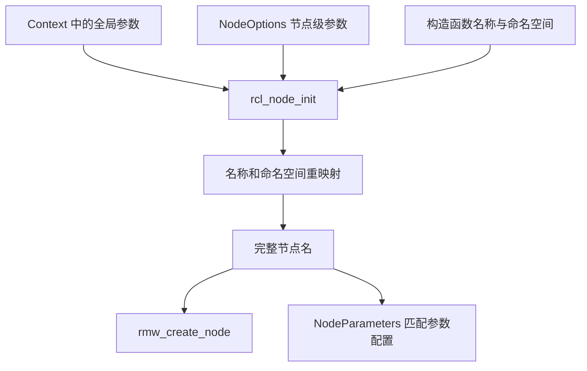

# 第 4 章 初始化、Context 与 Node

本章追踪初始化与节点配置：Context、NodeOptions、全局与节点级参数、名称重映射、参数覆盖及失败清理。

关键路径已按固定源码核验；当前环境缺少 ROS 构建工具链，探针待编译运行，输出为非实测预期。

## 4.1 初始化不是一个单独的开关

常见程序先调用 `rclcpp::init(argc, argv)`，再创建 Node。打开 [`utilities.cpp`](../../src/ros2/rclcpp/rclcpp/src/rclcpp/utilities.cpp)，可以看到这一入口先取得默认 Context 并调用其 `init()`，随后安装信号处理器。

```text
rclcpp::init(argc, argv)
  → 默认 Context::init(argc, argv, init_options)
  → 安装信号处理器
```

默认 Context 提供一个方便的公共入口，不代表框架只允许一个上下文。应用可以显式创建 Context，再通过 NodeOptions 把它交给节点。

需要留意两个接口的区别：直接调用显式 `Context::init()`，不会自动执行 `rclcpp::init()` 后面的信号处理器安装。本章的探针不运行执行器，正常结束时显式关闭上下文；若自己实现长期运行程序，还要明确中断信号、执行线程和关闭过程如何协作。

[`signal_handler.cpp`](../../src/ros2/rclcpp/rclcpp/src/rclcpp/signal_handler.cpp) 的处理过程会查看已登记的上下文及其 `shutdown_on_signal` 配置。信号、上下文关闭和对象析构仍然是不同机制，不能只因为安装了处理器，就假定任何线程与资源都按所需顺序完成清理。

## 4.2 Context::init 的实际工作

在 [`context.cpp`](../../src/ros2/rclcpp/rclcpp/src/rclcpp/context.cpp) 中，初始化首先加锁，并检查当前 Context 是否已经有效。如果是，抛出 `ContextAlreadyInitialized`。这防止对同一个正在运行的上下文再次初始化。

随后，函数清理旧状态、创建零初始化的 C 层上下文，再调用 `rcl_init()`。成功后才把该对象交给带删除器的共享指针管理，并继续配置日志、检查未识别 ROS 参数、保存初始化选项，以及登记上下文。

```text
检查重复初始化
  → 清理旧状态
  → 创建零初始化 rcl_context_t
  → rcl_init()
  → 日志配置与参数检查
  → 保存选项、登记上下文
```

登记时使用了 `shared_from_this()`。因此，显式 Context 应按共享所有权方式创建，例如 `std::make_shared<rclcpp::Context>()`，不能把所有权要求忽略后随意在栈上构造并初始化。

这里也有一个阅读失败路径的重要原则：底层初始化成功不等于整个 C++ 初始化已经成功。日志设置、未知参数检查和登记都可能在后续阶段出现问题。判断初始化是否完成，应以整个函数返回为界，而不是只观察 `rcl_init()` 返回成功。

### C 层怎样初始化

[`rcl/init.c`](../../src/ros2/rcl/rcl/src/rcl/init.c) 检查输入参数和上下文状态，建立内部实现结构，复制初始化选项与参数，解析 ROS 参数，再准备相关配置，最终调用 `rmw_init()`。

内部结构使用零初始化分配，使失败清理能够区分尚未建立的部分。发生错误时，多条分支转向 `fail` 标签，调用 `__cleanup_context()` 再返回错误。

因此，C++ 层在 `rcl_init()` 失败后删除外层 `rcl_context_t`，不能被解读为“它跳过了全部内部清理”。内部清理由失败路径负责。也不能由这一段代码推断所有资源故障都已经验证无泄漏；本章核验的是控制流程，全面的故障注入属于另一个验证范围。

## 4.3 两组参数：Context 全局参数与节点级参数

这里的“全局参数”指 Context 保存的进程级 ROS 命令行参数，不是所有节点共享一张运行时参数表。

调用 `Context::init(argc, argv)` 时，C 层解析输入并保存到 `rcl_context_t::global_arguments`。NodeOptions 还可以保存另一组只为特定节点提供的参数字符串，随后独立解析。

例如：

```cpp
auto context = std::make_shared<rclcpp::Context>();
context->init(argc, argv);

rclcpp::NodeOptions options;
options.context(context);
options.arguments({"--ros-args", "-r", "__node:=local_node"});
auto node = std::make_shared<rclcpp::Node>("first", options);
```

这是配置示意，不是完整程序。构造函数原始名称为 `first`，局部规则要求重映射为 `local_node`。如果进程命令行同时提供全局节点名规则，创建节点时会根据匹配规则选择适用来源。

`use_global_arguments(false)` 可以使这个节点不采用 Context 中的全局参数，但不会关闭上下文，也不会自动关闭节点级参数。它控制的是配置来源，而不是节点能否通信。

## 4.4 NodeOptions：哪些配置进入 C 层，哪些留在 C++ 层

[`node_options.hpp`](../../src/ros2/rclcpp/rclcpp/include/rclcpp/node_options.hpp) 给出了本地实现的默认配置，包括默认 Context、使用全局参数、启用 rosout、关闭进程内通信，以及启用参数服务和参数事件发布者。

| 配置 | 作用位置或主要用途 |
| --- | --- |
| `context()` | 决定 NodeBase 使用哪个上下文 |
| `arguments()` | 节点级参数，解析进入 C 层节点选项 |
| `use_global_arguments()` | 决定是否使用 Context 中的全局参数 |
| `enable_rosout()` | 进入底层节点配置，控制相关日志发布功能 |
| `use_intra_process_comms()` | C++ 层默认通信配置，后续端点使用 |
| `parameter_overrides()` | 提供节点参数初始覆盖值 |
| `start_parameter_services()` | 控制参数服务创建 |
| `automatically_declare_parameters_from_overrides()` | 控制是否自动声明覆盖值中的参数 |

不是所有 C++ 配置都会原样复制到一个 C 结构体。`Node` 构造时会把不同配置分别传给 NodeBase、NodeParameters 等职责对象。

### 延迟生成 C 层选项

[`node_options.cpp`](../../src/ros2/rclcpp/rclcpp/src/rclcpp/node_options.cpp) 中的 `get_rcl_node_options()` 按需建立 C 层节点选项：设置默认值、分配器和相关策略，把字符串参数组织为 C 接口输入，调用 `rcl_parse_arguments()`，最后检查未知 ROS 参数。

`arguments()` 的设置函数会清空已生成的选项缓存，让后续访问重新解析。这解释了为什么 NodeOptions 构造本身不一定触发全部参数处理，以及为什么修改字符串参数后需要重新生成配置。

配置节点之前应该完成选项设置。节点构造会使用这些配置，并保存选项；之后修改原来的 NodeOptions 变量，不是对已创建节点的通用实时配置接口。运行时参数更新有自己的机制，不能与构造选项混用。

## 4.5 NodeBase 如何使用配置与重映射

[`node.cpp`](../../src/ros2/rclcpp/rclcpp/src/rclcpp/node.cpp) 创建 NodeBase 时，传入节点名、命名空间、Context、C 层节点选项，以及进程内通信和统计相关默认配置。NodeBase 调用 `rcl_node_init()` 建立基础节点。

[`rcl/node.c`](../../src/ros2/rcl/rcl/src/rcl/node.c) 先检查上下文和输入，随后复制节点选项，根据 `use_global_arguments` 决定是否提供全局参数，再处理节点名和命名空间重映射，形成完整名称，最后进入 `rmw_create_node()` 等初始化工作。



[`remap.c`](../../src/ros2/rcl/rcl/src/rcl/remap.c) 的查找过程先检查局部规则；未匹配到适用规则时再检查全局规则。规则是否匹配仍受类型和节点等条件约束，不能将其简化为“局部字符串一定覆盖任意全局设置”。

最终节点名可能与构造函数中的字面值不同。需要观察实际身份时，应检查 `get_fully_qualified_name()`；分析参数文件匹配时，也需要考虑重映射后的完整节点名。

## 4.6 参数覆盖与参数声明是两件事

名字重映射与参数覆盖使用不同实现，不能因为它们来自同一组命令行参数，就把优先级解释完全混用。

[`resolve_parameter_overrides.cpp`](../../src/ros2/rclcpp/rclcpp/src/rclcpp/detail/resolve_parameter_overrides.cpp) 先处理全局来源，再处理局部来源，因此同名参数的局部值可以覆盖全局值；随后合并显式传入的 `parameter_overrides`，同名显式值再覆盖前面的值。匹配过程使用节点完整名称。

针对本章实验中的同一整数参数 `count`，三个来源可分别设为 10、20、30，观察有效初始值。但这些值不是凭空让节点完成了参数声明。

默认情况下，自动从覆盖值声明参数的选项是关闭的。只有调用 `declare_parameter()` 或明确启用自动声明等机制，参数才进入节点的声明状态。本章程序先检查 `has_parameter("count")`，再声明该参数，正是为了分别观察这两个阶段。

参数读取、类型校验、动态更新与回调会在参数章节展开；本章只追踪初始配置来源。

## 4.7 节点创建不等于执行器已经启动

NodeBase 初始化后建立默认互斥回调组，Node 随后组织图、话题、时钟、参数等接口。此时节点具有相应对象，但程序还没有自动进入无限调度循环。

参数服务或订阅的创建不保证用户回调已经运行；仍需相关执行器或专门执行机制处理。本章探针故意不调用 spin，只检查节点名称和本地参数声明。构建和检查这些对象，不需要为了形式完整而加一个无法结束的执行器循环。

还要区分“节点构造成功”和“远端已发现节点”。构造返回说明本次初始化路径成功，不是所有远端端点匹配完成的确认。

## 4.8 失败路径要按阶段分析

| 失败阶段 | 本地源码中的主要处理 | 对外表现 |
| --- | --- | --- |
| 有效 Context 被再次初始化 | 初始化前检查 | `ContextAlreadyInitialized` |
| C 层初始化失败 | C 层清理内部状态，C++ 删除外层对象并转换错误 | C++ 异常 |
| Context 后续参数检查失败 | 尝试 shutdown、释放 C 层 Context，再传播异常 | 初始化未正常返回 |
| NodeOptions 参数解析失败 | 转换错误或抛出未知参数异常 | 节点无法完成构造 |
| 节点名或命名空间无效 | NodeBase 针对相应错误进一步验证和转换 | 有意义的名称异常 |
| 节点构造中途失败 | 已构造成员按 C++ 规则清理，C 层处理相应失败资源 | 最外层 Node 未创建成功 |

最后一行有一个 C++ 细节：最外层对象构造失败时，不会调用这个未完成对象的析构函数，但已构造的成员会被销毁。因此，不能仅凭没有命中 `Node::~Node()` 就推断清理没有发生。

未初始化 Context 的使用还可能在 GuardCondition 等成员构造阶段就失败，不能假定每一种无效上下文错误都会走到同一个 `rcl_node_init()` 断点。错误的阶段应由实际调用栈确定。

## 4.9 实验准备：初始化探针

完整程序见 [`experiments/initialization/main.cpp`](../../experiments/initialization/main.cpp)，构建规则见 [`CMakeLists.txt`](../../experiments/initialization/CMakeLists.txt)。程序创建显式 Context，并比较第一个节点与拒绝全局参数的第二个节点。为减少无关工作，关闭 rosout、参数服务、参数事件与专用时钟线程。

以下操作以 Ubuntu 和 Bash 为例。apt 安装版可以验证一般行为；要对应本书源码，应先完成该源码构建，并在加载 apt 环境后加载本地安装环境。命令从书稿仓库根目录执行：

```bash
source /opt/ros/humble/setup.bash
export ROS_DOMAIN_ID=42
export RMW_IMPLEMENTATION=rmw_fastrtps_cpp
mkdir -p experiment-results
cmake -S experiments/initialization -B build/initialization \
  -DCMAKE_BUILD_TYPE=Debug
cmake --build build/initialization
```

前提是安装了 CMake、编译器、rclcpp 开发文件及所选 RMW。这里仅把探针构建为 Debug，不会为 apt 提供的依赖库自动补充完整调试信息。实验记录应包含操作系统、工具版本、ROS 包前缀、RMW、domain、源码提交及修改状态、构建命令和环境加载顺序。函数入口断点依赖可识别符号，源码行和变量观察需匹配的调试信息；本章程序的 Debug 配置不会为依赖库自动补齐符号。

### 实验一：全局配置与节点隔离

执行并保存输出：

```bash
./build/initialization/initialization_probe global \
  --ros-args -r __node:=global_node -p count:=10 \
  2>&1 | tee experiment-results/init-global.log
```

**预期关键输出，非实测：**

```text
first=/global_node has_count_before=0
first_count=10
second=/second second_count=0
```

第一个节点采用全局重映射及初始覆盖值；第二个节点关闭全局参数使用，因此保留名称和声明默认值。`has_count_before=0` 说明覆盖值并不等于已经声明参数。

若第一节点名称或值不同，检查实际程序版本、命令行、局部选项和环境。若出现其他日志，以关键输出为对照，不要求整段标准输出完全一致。

### 实验二：局部规则和显式覆盖

先运行带局部配置的模式：

```bash
./build/initialization/initialization_probe local \
  --ros-args -r __node:=global_node -p count:=10 \
  2>&1 | tee experiment-results/init-local.log
```

源码为第一节点提供局部名称 `local_node` 和 `count:=20`。预期输出为：

```text
first=/local_node has_count_before=0
first_count=20
second=/second second_count=0
```

再运行显式参数覆盖模式：

```bash
./build/initialization/initialization_probe overrides \
  --ros-args -r __node:=global_node -p count:=10 \
  2>&1 | tee experiment-results/init-overrides.log
```

预期名称仍为 `/local_node`，但 `first_count=30`，第二节点仍使用默认值 0。这分别检验名称规则匹配和参数覆盖合并，不证明所有重映射或参数文件场景都遵循无条件覆盖。

### 实验三：重复初始化与无效配置

程序的失败模式返回退出码 2。下面直接执行，不通过管道，以便 `$?` 对应探针本身：

```bash
./build/initialization/initialization_probe double-init
echo $?

./build/initialization/initialization_probe invalid-name
echo $?

./build/initialization/initialization_probe uninitialized
echo $?
```

**预期结果，非实测：**

| 模式 | 预期关键观察 | 退出码 |
| --- | --- | --- |
| `double-init` | 第二次初始化被捕获；`context_valid=1`；随后仍能正常构造节点 | 0 |
| `invalid-name` | `bad name` 不合法，构造失败；异常捕获时 Context 仍有效 | 2 |
| `uninitialized` | 没调用 Context 初始化，节点相关构造失败；Context 无效 | 2 |

精确异常字符串依版本可能不同，应保存实际文本。无效名称失败时，程序随后关闭仍有效的 Context；不把“构造失败”当成整个进程必须崩溃。

需要进一步核对失败阶段时，可运行 `gdb --args ./build/initialization/initialization_probe invalid-name`，在 GDB 中输入：

```gdb
set breakpoint pending on
catch throw
run
bt
```

`catch throw` 可能捕获多次异常抛出；每次保存调用栈，再用 `continue` 继续。需要专门观察重抛时可另设 `catch rethrow`。捕获点可能停在运行库中，应通过调用栈定位自己的代码，参见 [GDB 异常捕获文档](https://sourceware.org/gdb/current/onlinedocs/gdb.html/Set-Catchpoints.html)。源码行和变量观察依赖匹配的调试信息。观察的是实际失败阶段，不要求各模式停在同一函数。

### 实测记录

| 实验 | 状态 | 实际名称、值或错误 | 日志与环境记录 | 结论 |
| --- | --- | --- | --- | --- |
| 全局配置与隔离 | 待执行 | 待填写 | 待填写 | 待填写 |
| 局部与显式覆盖 | 待执行 | 待填写 | 待填写 | 待填写 |
| 重复初始化 | 待执行 | 待填写 | 待填写 | 待填写 |
| 无效名称与上下文 | 待执行 | 待填写 | 待填写 | 待填写 |

## 4.10 本章小结

初始化建立的不只是一个有效标志，而是一组上下文、参数和底层状态。Context 承接进程级配置，NodeOptions 提供节点配置，再由 Node 的不同职责对象分别使用。

节点名重映射发生在基础节点创建路径，参数覆盖则在参数接口中按来源合并；覆盖初始值与声明参数又是不同步骤。理解这些边界，才能解释同一进程中节点为何使用不同名称和参数，也能在失败时定位真正出错的阶段。

下一章转向接口生成：从 `.msg` 输入开始，追踪消息结构和类型支持如何生成，补齐前面创建通信端点时使用的类型信息。

## 源码索引与核验范围

正文链接对应本地基线。已核验默认初始化入口、Context 初始化、NodeOptions 延迟解析、名称重映射和参数覆盖合并，以及所述关键错误处理。尚未编译探针或运行实验；未展开所有日志故障、平台差异、分配失败和并发初始化条件。
