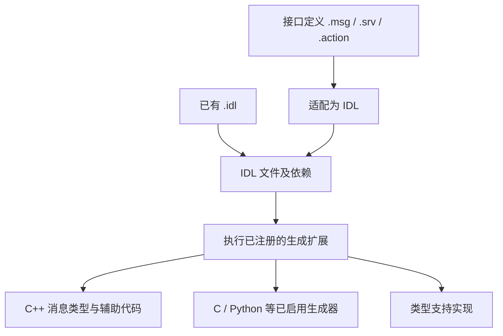

# 第 5 章 消息定义如何变成代码

第 2 章的 Talker 包含 `std_msgs/msg/string.hpp`，却不直接声明字符串消息类；第 3 章又看到创建发布者时传入类型支持。它们都与接口定义有关，但不是同一种产物。

本章从 `String.msg` 出发，追踪接口如何进入构建系统、转换为 IDL、生成 C++ 类型与类型支持，并连接到中间件序列化入口。我们也会构建一个小型接口包，通过生成文件和数据往返验证理解。

分析仍以本书固定的 `ros2_humble` 源码为基线。关键生成规则和模板已按本地源码核验；当前环境没有 ROS 构建工具链，实验程序尚未编译运行。下文的结构示意和预期输出不作为实际生成文件或实测日志。

## 5.1 一行定义，几类产物

[`String.msg`](../../src/ros2/common_interfaces/std_msgs/msg/String.msg) 的有效字段定义只有：

```text
string data
```

它表达了接口的字段名称和类型，没有规定应用如何启动节点，也没有直接实现网络发送。构建系统围绕这份接口产生几类东西：

| 产物 | 回答的问题 |
| --- | --- |
| 语言消息类型 | C++ 或其他语言怎样保存字段 |
| 构造与 traits 辅助 | 怎样构造、识别和描述这种消息 |
| 类型支持声明与实现 | 怎样把消息类型连接到运行时支持 |
| 序列化或内省支持 | 怎样编码字段，或描述字段结构 |

这里不应把 `.msg` 文件理解为某一种传输报文，也不能把生成的 C++ 对象当成可以直接原样发送的字节数组。

## 5.2 构建入口：rosidl_generate_interfaces

在 [`std_msgs/CMakeLists.txt`](../../src/ros2/common_interfaces/std_msgs/CMakeLists.txt) 中，构建文件查找 `rosidl_default_generators`，列出消息文件，再调用：

```cmake
rosidl_generate_interfaces(${PROJECT_NAME}
  ${msg_files}
  DEPENDENCIES builtin_interfaces
  ADD_LINTER_TESTS
)
```

这里节选了真实构建入口。接口列表是生成系统的输入，依赖声明让生成过程能够处理其他包的类型引用。例如同一包的 Header 使用时间类型；不能因为 String 自身只有字符串，就断言整个 std_msgs 包没有接口依赖。

[`rosidl_generate_interfaces.cmake`](../../src/ros2/rosidl/rosidl_cmake/cmake/rosidl_generate_interfaces.cmake) 检查输入文件、整理接口与依赖，并组织后续生成工作。它不是把每种语言的输出规则全部硬编码在一个函数里，而是通过生成扩展点让不同生成器接入。

需要区分 CMake 配置阶段与构建阶段：配置过程中既会整理规则，也可能执行接口适配；语言生成器还会定义后续构建目标。不能只看到生成入口宏，就认定所有文件都在同一时刻写出。

## 5.3 适配：从 .msg 到 .idl

本地生成入口将已有 `.idl` 与需要适配的接口分开。对于 `.msg` 等输入，如果具备适配器，则调用 `rosidl_adapt_interfaces()` 获得后续处理使用的 IDL。

[`rosidl_adapter/msg/__init__.py`](../../src/ros2/rosidl/rosidl_adapter/rosidl_adapter/msg/__init__.py) 中的 `convert_msg_to_idl()` 读取文件内容，调用 `parse_message_string()` 得到消息描述，再通过模板展开写入 IDL。

```text
String.msg
  → 解析字段和相关定义
  → 展开适配模板
  → String.idl
```

IDL 不只是把扩展名换掉。它组织模块、结构体、字段和相关注解，使后续生成器有统一输入。对应 String 的结构可以概念性地表示为：

```idl
module std_msgs {
  module msg {
    struct String {
      string data;
    };
  };
};
```

这是结构示意，省略了实际模板可能写入的注释和注解。实验应检查真正生成的 IDL，而不是把这段文字当成生成器的逐字输出。

`.srv` 与 `.action` 同样参与接口生成，但会产生请求、响应或动作相关结构。它们不是换个文件后缀就仍然只有一个普通消息类；具体拆分在服务与动作章节展开。

## 5.4 生成器怎样接入

[`register_cpp.cmake`](../../src/ros2/rosidl/rosidl_generator_cpp/cmake/register_cpp.cmake) 将 C++ 生成器注册到 `rosidl_generate_idl_interfaces` 扩展点。主入口准备好 IDL 文件和依赖后，执行这些已注册扩展。

接着，C++ 生成器建立输出和构建规则，调用 Python 入口进行模板展开。[`rosidl_generator_cpp/__init__.py`](../../src/ros2/rosidl/rosidl_generator_cpp/rosidl_generator_cpp/__init__.py) 的 `generate_cpp()` 列出模板到输出文件的映射，包括入口头文件、结构体、builder、traits 和类型支持声明。



图中的分支表示多类生成产物，不规定所有环境都会启用相同生成器。实际输出取决于已安装和已注册的工具、构建配置及依赖。

## 5.5 string.hpp 是入口，不是全部实现

[`idl.hpp.em`](../../src/ros2/rosidl/rosidl_generator_cpp/resource/idl.hpp.em) 是入口头文件模板。它把接口名转换为文件命名形式，并包含四类 detail 头文件。

对于 String，生成结果的主要关系是：

```text
std_msgs/msg/string.hpp
  ├─ detail/string__struct.hpp
  ├─ detail/string__builder.hpp
  ├─ detail/string__traits.hpp
  └─ detail/string__type_support.hpp
```

因此，查到 `string.hpp` 后若只看到 include 列表，不是打开了错误文件，而是遇到了统一入口。分析字段布局应继续进入 struct 文件；分析类型特征则进入 traits 文件。

这些头文件既可能出现在构建树，也可能被安装到 include 目录。不同安装布局可以增加包名前缀层级，不应仅凭某个固定磁盘路径判断生成失败。编译器使用的 include 名称与文件的绝对路径不是一回事。

## 5.6 C++ 消息类型：字段、分配器和指针别名

[`msg__struct.hpp.em`](../../src/ros2/rosidl/rosidl_generator_cpp/resource/msg__struct.hpp.em) 生成带分配器参数的结构体，再提供使用默认分配器的别名。String 的核心关系可概念性地表示为：

```cpp
template<class ContainerAllocator>
struct String_ {
  // 字符串实际声明也使用与分配器关联的类型。
  // 此处只展示结构，不复制完整生成代码。
};
using String = String_<std::allocator<void>>;
```

语言映射在生成器 Python 代码中定义。字符串使用 `std::basic_string` 并关联字符分配器；普通序列和有界序列会有相应容器表示。应用使用的 `std_msgs::msg::String` 是默认配置下的类型别名，不需要每次手写分配器参数。

模板也生成初始化构造函数、字段设置函数、比较运算及指针别名。例如上一章代码中的 `ConstSharedPtr` 就来自这种生成结构。指针别名方便表达所有权，但不会自动让网络传输变成零拷贝。

`MessageInitialization` 则控制生成构造函数怎样处理默认与零初始化。它不是通信 QoS，也不是上下文初始化状态；同样带有“初始化”这个名字，作用对象完全不同。

## 5.7 traits：有界与固定大小不是一回事

[`msg__traits.hpp.em`](../../src/ros2/rosidl/rosidl_generator_cpp/resource/msg__traits.hpp.em) 根据字段生成 `is_message`、`has_fixed_size` 和 `has_bounded_size` 等特征。

String 使用无界字符串，因此不是固定大小，也没有由定义给出的最大大小。若将字符串写为有界形式，例如 `string<=16 label`，就表达长度上界；数据仍可以有不同长度，不会因此变成固定大小类型。

同样，`uint8[<=8]` 是最多八个元素的有界序列，`uint8[8]` 才表示固定长度数组。实验使用前者，以便同时观察“有界为真、固定大小为假”。

这些 traits 描述接口特征，不是网络负载长度测量。结构体的 `sizeof`、字段内容大小和序列化字节数也不能互相替代。有界类型还不能单独保证零拷贝、无动态分配或可借用消息，这些能力需要结合具体类型表示和中间件支持判断。

## 5.8 类型支持句柄不保存本次消息数据

发布者创建时取得 `rosidl_message_type_support_t`。它定义在 [`message_type_support_struct.h`](../../src/ros2/rosidl/rosidl_runtime_c/include/rosidl_runtime_c/message_type_support_struct.h)，关键成员为：

```text
typesupport_identifier：类型支持实现标识
data：该实现使用的支持数据
func：取得相应类型支持的函数入口
```

`data` 不是本次消息的 `data` 字段。不同实现可以把它用于不同支持结构，例如回调表或类型支持映射表。不能看到一个通用指针，就把它直接转换为 String 消息对象。

[`rosidl_typesupport_cpp` 的生成模板](../../src/ros2/rosidl_typesupport/rosidl_typesupport_cpp/resource/msg__type_support.cpp.em) 为消息生成 `get_message_type_support_handle<MessageT>()` 特化。配置只有一个支持实现时可以直接转交该实现；多个实现时则可能返回带映射的分派句柄。

[`type_support_dispatch.hpp`](../../src/ros2/rosidl_typesupport/rosidl_typesupport_cpp/src/type_support_dispatch.hpp) 按请求的 identifier 查找支持，在需要时构造库名、加载共享库、查找符号并取得具体句柄。因此不能无条件写成“类型支持必然动态加载一次”，也不能把通用入口标识当成最终使用的中间件类型支持标识。

内省支持描述字段结构等信息，特定中间件支持则连接相应编码与通信机制。它们都是类型支持体系的一部分，但职责不同。

## 5.9 从类型支持到序列化

在本地 [`rmw_fastrtps_cpp/src/publisher.cpp`](../../src/ros2/rmw_fastrtps/rmw_fastrtps_cpp/src/publisher.cpp) 中，发布者创建过程尝试取得 Fast RTPS C++ 或 C 类型支持，并继续建立相关对象。

[`msg__type_support.cpp.em`](../../src/ros2/rosidl_typesupport_fastrtps/rosidl_typesupport_fastrtps_cpp/resource/msg__type_support.cpp.em) 生成序列化、反序列化和大小计算相关函数，并把它们连接到回调表与支持句柄。第 2 章发布入口携带的类型支持信息，正是在后续处理消息字段时发挥作用。

[`TypeSupport_impl.cpp`](../../src/ros2/rmw_fastrtps/rmw_fastrtps_shared_cpp/src/TypeSupport_impl.cpp) 在普通消息序列化路径中创建 CDR 处理对象，调用对应消息序列化过程。不能直接将含字符串对象的 C++ 内存块按 `sizeof` 发出；其中可能包含容器管理状态和指针，而不是可跨进程直接解释的字段编码。

本章只连接到字段序列化入口，不展开整个 DDS 协议、发现与传输实现。生成类型、生成支持代码和真正的通信过程应分别追踪。

## 5.10 实验准备：一个小型接口包

实验包位于 [`experiments/interfaces/book_interfaces`](../../experiments/interfaces/book_interfaces)。它将接口和检查程序放在同一个包中，便于观察生成目标与程序链接；实际工程也可以将接口包与应用包分开。

[`Readout.msg`](../../experiments/interfaces/book_interfaces/msg/Readout.msg) 定义为：

```text
uint32 sample_id
string<=16 label
uint8[<=8] payload
```

[`CMakeLists.txt`](../../experiments/interfaces/book_interfaces/CMakeLists.txt) 调用生成入口，并用 `rosidl_get_typesupport_target()` 取得 C++ 类型支持目标，再将其链接到 roundtrip 程序。这样程序的生成头文件依赖与类型支持链接通过构建目标关联，而不是手工猜测库文件地址。

以下以 Ubuntu、Bash 和 apt 安装环境为例。安装开发依赖后，从书稿仓库根目录执行：

```bash
source /opt/ros/humble/setup.bash
export ROS_DOMAIN_ID=42
export RMW_IMPLEMENTATION=rmw_fastrtps_cpp
mkdir -p experiment-results
colcon build --base-paths experiments/interfaces \
  --build-base build/interfaces --install-base install/interfaces \
  --packages-select book_interfaces \
  --cmake-args -DCMAKE_BUILD_TYPE=Debug
source install/interfaces/setup.bash
```

前提是具备 colcon、编译器、ament、rclcpp、默认接口生成器及所选 RMW。apt 缺包时先安装 `ros-humble-rosidl-default-generators`、`ros-humble-rclcpp` 和 `ros-humble-rmw-fastrtps-cpp` 等所需组件。

这里仅构建实验目录中的包，使用当前已加载的工具与依赖。若要核验本书生成器版本，应先构建对应源码工具链，并用其安装环境作为基础；不能将 apt 生成文件自动视作本地模板的逐字输出。记录操作系统、编译器、生成器和 ROS 包版本、安装前缀、RMW、domain、源码提交及修改状态、构建命令和环境加载顺序，并保存本次实际生成文件清单。

### 实验一：逐层查找生成文件

构建成功后执行：

```bash
find build/interfaces/book_interfaces -type f \
  \( -name 'Readout.idl' -o -name 'readout*.hpp' -o -name '*type_support*.cpp' \) \
  | sort | tee experiment-results/interface-files.txt

find install/interfaces -type f \
  \( -name 'readout*.hpp' -o -name '*book_interfaces*typesupport*.so' \) \
  | sort | tee experiment-results/interface-install.txt
```

按输出路径打开适配后的 IDL、`readout.hpp` 和 `readout__struct.hpp`，核对字段、模块名、头文件关系和有界类型。再搜索特征及支持函数：

```bash
grep -R -n -E 'has_fixed_size|has_bounded_size|is_message' \
  build/interfaces/book_interfaces/rosidl_generator_cpp
grep -R -n -E 'cdr_serialize|cdr_deserialize|get_message_type_support_handle' \
  build/interfaces/book_interfaces --include='*.cpp' --include='*.hpp'
```

**预期结果，非实测：**找到适配 IDL、入口及 detail 头文件；traits 表明该类型是消息、有界但非固定大小；支持实现中可观察到相关符号。启用 Fast RTPS 支持时可查到 CDR 处理代码。具体文件集合取决于启用的生成器，不预设全部语言或库都出现。

发现缺项时，先检查构建是否成功、生成器是否启用以及实际路径，不能只根据查不到某个固定路径就断言工具失效。记录真实文件路径，不把正文示意目录复制为实测清单。

### 实验二：序列化并恢复字段

检查程序见 [`roundtrip.cpp`](../../experiments/interfaces/book_interfaces/src/roundtrip.cpp)。它创建 sample_id 为 7、label 为 sensor、payload 为三个字节的消息，打印 traits 和类型支持入口标识，再使用 `rclcpp::Serialization` 序列化和反序列化。它没有创建发布者或订阅者。

执行并保存结果：

```bash
set -o pipefail
ros2 run book_interfaces roundtrip 2>&1 \
  | tee experiment-results/interface-roundtrip.txt
echo $?
```

**预期关键输出，非实测：**

```text
is_message=1 fixed_size=0 bounded_size=1
typesupport=<实际入口标识>
serialized_bytes=<实际字节数>
sample_id=7 label=sensor payload_size=3
roundtrip_equal=1
```

正常往返一致时退出码为 0，不一致为 1，异常为 2。输出中的占位内容由真实运行填写，不打印这些尖括号文本。字节数可能包含长度、对齐和编码相关开销，不能用字段字符串长度直接代替。

[`serialization.cpp`](../../src/ros2/rclcpp/rclcpp/src/rclcpp/serialization.cpp) 中的实现分别调用 `rmw_serialize()` 和 `rmw_deserialize()`，因此实验虽然没有话题端点，仍需当前环境提供对应的消息类型支持与 RMW 编码能力。

这个实验验证当前环境中同一类型的编码与恢复，不验证远端发现、网络传输、跨版本兼容或端到端零拷贝。程序打印的初始支持标识也不单独证明最终分派到哪个实现，应进一步检查实际 RMW 与支持路径。

### 实验三：修改接口，观察重新生成

实验前保存接口原文件；在 `Readout.msg` 最后追加一行 `bool valid`，重新执行上面的构建命令，然后查看生成结构与 traits。程序未赋值的新字段使用生成构造函数的初始化逻辑，原程序仍可比较两份完整消息。

重新运行 roundtrip，记录新结构、字段初始化和字节数。**预期**结构体新增字段，类型仍然有界但非固定大小；数据往返仍应一致。序列化长度不保证一定增加一字节，因为布局和对齐也参与结果。

实验结束恢复原定义，再构建一次，使代码回到本章基线。不要手改生成头文件：下一次生成可能覆盖它，而且支持实现可能与手改结构不一致。构建后重新启动程序，确保没有继续使用旧进程或旧安装环境。

### 实测记录

| 实验 | 状态 | 实际观察 | 证据与环境 | 结论与限制 |
| --- | --- | --- | --- | --- |
| 生成文件追踪 | 待执行 | IDL、头文件、traits 与支持产物 | 待填写 | 待填写 |
| 数据往返 | 待执行 | 标识、字节数、字段、退出码 | 待填写 | 待填写 |
| 修改后重新生成 | 待执行 | 新字段、初始化、布局变化 | 待填写 | 待填写 |

## 5.11 本章小结

接口定义通过适配、解析与生成扩展，变成语言类型、辅助代码及类型支持。应用使用的入口头文件只是这些结构的汇合点；字段布局、特征描述和运行时支持分别位于不同产物中。

类型支持把消息类型连接到具体处理机制，序列化则把字段编码为可恢复的数据表示。它们既不是节点创建，也不是远端回调调度。理解这条生成链，才能解释为何发布者创建时需要类型支持，以及为什么消息对象的内存布局不能直接当成传输格式。

下一章回到 Publisher 与 Subscription 的创建路径，具体连接消息类型、QoS、端点句柄和普通发布、取出操作。

## 核验范围

正文链接指向本地基线，结构示意已注明。已核验 std_msgs 构建入口、适配器、C++ 生成器及模板、traits、类型支持分派与 Fast RTPS 序列化相关入口。实验尚未编译运行，未展开全部生成器、DDS 编码规范和接口兼容条件。
