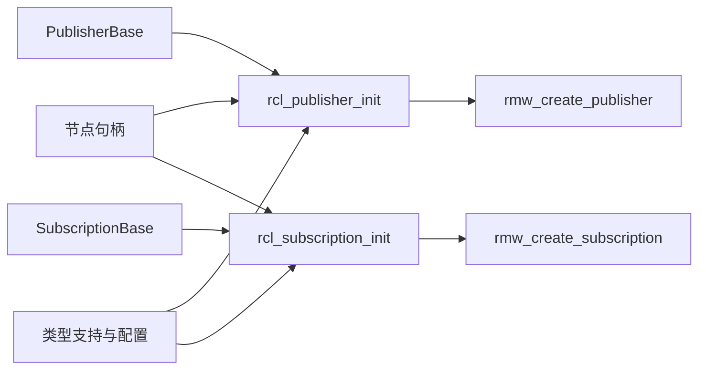

# 第 6 章 Publisher 与 Subscription

本章分析 Publisher 与 Subscription 的创建，以及类型支持、QoS、话题名称、回调登记和普通 publish/take 路径。进程内通信、类型适配和借用消息在后续章节展开。

本章重点是端点创建及 publish/take 的输入、结果与错误边界。执行器调用 take 的路径只作定位；等待与唤醒见[第 8 章](chapter-08-waitset-guard-timer.md)，工作选择、回调执行和并发约束见[第 9 章](chapter-09-executor-callback-groups.md)。

关键接口与分支已按固定源码核验；实验待编译运行，输出为非实测预期。

## 6.1 创建时的输入比发布时更多

创建发布者需要消息类型、话题、QoS、节点及选项；普通发布操作通常只需要端点对象和消息。订阅创建还需要用户回调与消息内存策略。

| 配置 | 在创建过程中承担的角色 |
| --- | --- |
| 消息类型 | 决定具体 C++ 对象及类型支持 |
| 话题名称 | 经展开与重映射形成端点使用的名称 |
| QoS | 转换为中间件配置，参与端点行为与兼容性 |
| NodeBase | 提供上下文关联及节点句柄 |
| 发布/订阅选项 | 提供分配器、回调组及其他策略 |
| 用户回调 | 订阅成功取出数据后的处理入口 |

创建完成后，端点已经与这些信息关联。因此每次 `publish()` 不必重新指定话题与类型支持。但创建成功不是远端已经匹配的确认，也不意味着订阅回调立即运行。

## 6.2 模板接口怎样进入非模板实现

[`create_publisher.hpp`](../../src/ros2/rclcpp/rclcpp/include/rclcpp/create_publisher.hpp) 取得节点的话题接口，整理实际 QoS，构造类型相关工厂，再请求创建和登记端点。

[`publisher_factory.hpp`](../../src/ros2/rclcpp/rclcpp/include/rclcpp/publisher_factory.hpp) 把 `MessageT`、分配器和选项封装到创建函数中。NodeTopics 不需要为每一种消息写一套实现，而是调用工厂，再以 `PublisherBase` 接口处理共同职责。

```text
Node::create_publisher<MessageT>()
  → rclcpp 创建辅助函数
  → 类型相关 PublisherFactory
  → NodeTopics::create_publisher()
  → Publisher<MessageT> / PublisherBase
  → NodeTopics::add_publisher()
```

这里的基类不表示消息变成了无类型数据。类型相关行为仍在具体对象及其支持结构中，基类为公共操作提供接口。

订阅有对应的 [`create_subscription.hpp`](../../src/ros2/rclcpp/rclcpp/include/rclcpp/create_subscription.hpp) 和 [`subscription_factory.hpp`](../../src/ros2/rclcpp/rclcpp/include/rclcpp/subscription_factory.hpp)。它还把用户函数交给 `AnySubscriptionCallback`，携带消息内存策略与可选统计对象，创建具体 Subscription，再返回公共基类接口。

## 6.3 为什么构造之后还有 post_init_setup

发布工厂先调用 `make_shared`，再调用 `post_init_setup()`。源码注释指出，某些设置需要 `shared_from_this()`，不能在对象尚未建立共享所有权的构造函数阶段完成。

因此，看到构造函数返回，不代表工厂的全部设置结束。创建过程必须连同后初始化步骤一起阅读，特别是在研究进程内通信时。

订阅工厂也有相同形式的调用；但本地 `Subscription::post_init_setup()` 本身没有进一步工作。不能因为两个接口名字相同，就认为其内部处理完全对称。分析应以具体版本和函数内容为准。

## 6.4 基类创建底层端点句柄

[`publisher_base.cpp`](../../src/ros2/rclcpp/rclcpp/src/rclcpp/publisher_base.cpp) 管理 `rcl_publisher_t`，将节点句柄、类型支持、话题名和选项传给 `rcl_publisher_init()`。订阅基类在 [`subscription_base.cpp`](../../src/ros2/rclcpp/rclcpp/src/rclcpp/subscription_base.cpp) 中同样管理零初始化的 C 句柄，并调用 `rcl_subscription_init()`。



底层创建失败时，C 层整理状态与错误，上层转换为异常。成功后，基类设置的删除器在最后一份相关共享持有关系释放时调用对应 `fini`，再删除句柄内存。节点共享句柄保护清理依赖，这一持有关系已在第 3 章展开。

## 6.5 话题名称在哪里确定

[`rcl/publisher.c`](../../src/ros2/rcl/rcl/src/rcl/publisher.c) 在建立 RMW 发布者之前，对话题进行展开与重映射；[`rcl/subscription.c`](../../src/ros2/rcl/rcl/src/rcl/subscription.c) 对订阅进行对应处理。进入 RMW 创建接口时，使用的是整理后的名称。

构造时的 `stream` 可以是相对名称。默认根命名空间中它通常成为 `/stream`；节点在 `/book` 命名空间时则成为 `/book/stream`。若同时给出重映射，最终名称还会变化。

端点的 `get_topic_name()` 查询 C 层保存的实际名称。排查收发不通时，应对照两端最终名称，而不是仅比较源码里的两个字符串。

不过，名称相同仍不等于通信已建立。消息类型、QoS、domain、发现配置和具体实现状态都需要检查。名字解析只解决端点身份的一部分。

## 6.6 QoS 怎样从 C++ 进入 RMW

[`qos.cpp`](../../src/ros2/rclcpp/rclcpp/src/rclcpp/qos.cpp) 中，`QoS(size_t)` 转为 KeepLast 初始化，QoS 对象内部保存 `rmw_qos_profile_t`。创建端点时，相关选项携带该配置，C 层把它传给 RMW 创建接口。

```text
rclcpp::QoS
  → C 层端点选项的 qos
  → rmw_create_publisher / rmw_create_subscription
  → 实现相关端点配置
```

启用了 QoS 参数覆盖时，创建辅助函数还可能先整理覆盖后的实际配置。不能只看用户传入的一个 QoS 变量就结束追踪。

C 层创建完成后会取得实现报告的实际 QoS；C++ 的 `get_actual_qos()` 提供查询入口。“用户请求配置”和“实现报告配置”需要分别记录，特别是使用系统默认策略时。

历史深度不表示回调批次，也不是两端必须数值相同的条件。本章只追踪配置如何传递，可靠性、持久性和发现兼容规则由第 7 章展开。

## 6.7 登记订阅，还要让执行器知道变化

[`node_topics.cpp`](../../src/ros2/rclcpp/rclcpp/src/rclcpp/node_interfaces/node_topics.cpp) 的 `add_subscription()` 选择指定或默认回调组，登记订阅及相关 QoS 事件等待对象。如果有进程内等待对象，也会登记。随后触发节点与回调组通知，让等待中的执行器有机会重新检查工作。

显式提供回调组时，代码检查它是否属于当前节点。创建了一个回调组并不意味着可以把它交给任意节点的端点使用。

发布者的登记主要处理相关事件等待对象和通知；不能根据名称 `add_publisher()` 就断言回调组永久持有所有发布者。

订阅回调组保存弱引用，因此应用应保存返回的订阅共享指针。登记、持有和调度是三个不同问题：对象必须存活，工作必须被发现，执行器必须实际执行，用户函数才可能运行。

## 6.8 普通 publish 的语义与错误边界

[`publisher.hpp`](../../src/ros2/rclcpp/rclcpp/include/rclcpp/publisher.hpp) 提供多个重载。对于普通 ROS 消息，常见输入是常量引用或独占指针。未启用进程内通信时，它们进入 `do_inter_process_publish()`，调用 `rcl_publish()` 再交给 `rmw_publish()`。

这里 **inter-process 表示进程间，intra-process 表示进程内**。函数名描述客户端库选择的路径：同一进程中的两个节点，如果没启用进程内机制，也可能经普通中间件路径通信。

独占指针输入表达所有权转移，常量引用输入不表达同一种转移。但不能直接从输入类型推出端到端复制次数；复制、编码和缓冲行为还要进入后续实现分析。

普通 publish 正常返回，说明该次调用没有以异常报告失败，不是远端应用已处理消息的确认。发布日志若位于调用之前，证据更弱；本章实验特意在返回后打印 `publish_returned`，但也不将其解释为远端确认。

实现还对上下文关闭造成的无效状态作特定处理，因此正常运行时与关闭阶段的返回行为不能不加条件地混用。异常、可靠性和实际接收情况应分别判断。

## 6.9 take 与回调分发可以分开

普通执行器路径在选中订阅后准备接收对象，调用 `take_type_erased()`，成功时调用 `handle_message()`，再通过回调分发进入用户函数。这条路径已在第 2 章建立。

本地 [`subscription.hpp`](../../src/ros2/rclcpp/rclcpp/include/rclcpp/subscription.hpp) 还公开 `take(message, message_info)`。普通 ROS 类型的重载直接转入 `take_type_erased()`，并不会顺便执行已登记回调。

```text
执行器调度：take → 成功后 handle_message → 用户回调
主动取出：Subscription::take → 返回结果与消息
```

这是一个有用的边界：用户回调通常依赖执行器，但主动取出数据本身并非只能由执行器发起。本章用不运行 spin 的接收模式验证它。

返回值为 true 才表示取得可供使用的消息。文档还提醒，某些过滤重复进程内样本的路径可能已写入输出对象，却最终返回 false。因此不能只发现目标对象内容改变就当成一次有效接收。没有样本可取也不是必然的通信错误。

同一订阅不应在本章实验中同时交给执行器取出和手动 take，否则两条路径可能竞争样本，结果无法按单一消费路径解释。

## 6.10 实验：端点创建、名称和主动取出

程序位于 [`experiments/endpoints/main.cpp`](../../experiments/endpoints/main.cpp)，构建规则见 [`CMakeLists.txt`](../../experiments/endpoints/CMakeLists.txt)。三个模式分别是发布、执行器回调接收和主动 take。两端显式关闭进程内通信，使用 String、Reliable、Volatile、KeepLast，发布深度 7、订阅深度 10。

发布进程等待最多十秒观察订阅者，再发送五条样本；接收进程最多等待三十秒。正常收到五条时结束，不一致或超时返回 1，异常或用法错误返回 2。发布端正常退出不能替代接收端结果。

以下操作以 Ubuntu 和 Bash 为例，从书稿根目录执行。前提是编译器、CMake、rclcpp、std_msgs 和所选 RMW 已安装。apt 环境验证其安装版本，核对本书源码则加载对应本地安装环境。

```bash
source /opt/ros/humble/setup.bash
export ROS_DOMAIN_ID=42
export RMW_IMPLEMENTATION=rmw_fastrtps_cpp
mkdir -p experiment-results
cmake -S experiments/endpoints -B build/endpoints -DCMAKE_BUILD_TYPE=Debug
cmake --build build/endpoints
```

其他终端也要进入同一书稿根目录、加载相同环境并设置相同 domain 和 RMW。实验期间不要在同一话题运行其他接收程序；额外订阅会干扰发布端等待条件。

### 实验一：端点创建与回调接收

终端 A 先启动接收程序：

```bash
set -o pipefail
./build/endpoints/endpoint_probe callback 2>&1 \
  | tee experiment-results/endpoint-callback.txt
echo $?
```

三十秒内，在终端 B 启动发布程序：

```bash
set -o pipefail
./build/endpoints/endpoint_probe publish 2>&1 \
  | tee experiment-results/endpoint-publish.txt
echo $?
```

**预期关键结果，非实测：**两端显示 `/stream`；实现报告深度通常对应所请求的 7 和 10，应以实际输出为准。发布端打印五条 `publish_returned=sample:N`，接收端打印五条 `callback=sample:N`，最终为：

```text
callback_count=5 take_count=0
```

接收端退出码为 0。若超时，检查端点最终名称、环境、domain、RMW、是否启动及时，以及有没有其他订阅使发送提前开始。不得将缺少的样本补写为实测。

### 实验二：名称展开与重映射

重新运行两端，都追加同样参数：

```bash
./build/endpoints/endpoint_probe callback \
  --ros-args -r __ns:=/book -r stream:=renamed
```

```bash
./build/endpoints/endpoint_probe publish \
  --ros-args -r __ns:=/book -r stream:=renamed
```

仍先启动接收端再启动发送端。预期两端 `topic=/book/renamed`，接收结果与实验一相同。先记录实际名称，再解释重映射，不把源代码中的 `stream` 当成最终端点名。

### 实验三：没有 spin，主动 take 仍可接收

终端 A 改用主动取出模式：

```bash
set -o pipefail
./build/endpoints/endpoint_probe take 2>&1 \
  | tee experiment-results/endpoint-take.txt
echo $?
```

终端 B 运行默认 publish 模式。程序此时不调用 `spin_some()`，而是循环 `sub->take()`。预期关键输出为：

```text
take=sample:1 from_intra_process=0
...
take=sample:5 from_intra_process=0
callback_count=0 take_count=5
```

省略号表示中间几条样本，不是程序输出。这个结果说明数据取出与用户回调分发是不同操作。它不说明执行器没有用途，也不验证所有进程内、借用或类型适配路径。

### 可选：断点观察端点建立与取出

在 GDB 中启动 `endpoint_probe take`，设置下列断点后运行；另一个终端按前面的时限启动发布程序：

```gdb
set breakpoint pending on
break rcl_subscription_init
break rcl_take
run
```

命中时输入 `bt` 保存调用栈，再 `continue`。`rcl_take` 会在轮询中反复命中，可以在保存一份栈后用 `info breakpoints` 查编号并禁用该断点。调试暂停可能导致超时，若需要长时间检查，先调整探针等待期限并记录修改。

发布模式可对应观察 `rcl_publisher_init` 和 `rcl_publish`。函数断点不必要求完整 Debug 依赖，但源码行与变量需要匹配调试信息。默认 GDB 会暂停被调试进程全部线程，不能用断点下的延迟判断正常性能。

### 实测记录

| 实验 | 状态 | 名称、QoS 与样本计数 | 日志、环境与退出码 | 结论与限制 |
| --- | --- | --- | --- | --- |
| 回调接收 | 待执行 | 待填写 | 待填写 | 待填写 |
| 名称重映射 | 待执行 | 待填写 | 待填写 | 待填写 |
| 主动 take | 待执行 | 待填写 | 待填写 | 待填写 |

## 6.11 本章小结

端点创建把消息类型、支持信息、话题名称、QoS 与节点句柄连接起来。类型工厂负责具体对象，公共基类管理底层句柄，NodeTopics 则处理登记和通知。

创建、匹配、发布返回、数据取出和回调执行分别提供不同证据。特别是 `take()` 与回调分发的分离，让我们可以精确解释“数据已可取，但应用回调尚未运行”的含义。

下一章继续追踪 QoS 与发现：哪些配置决定端点是否兼容，图中看到端点与真正建立通信有何区别，以及怎样验证这些条件。

## 核验范围

已检查创建辅助函数、工厂与后初始化、基类句柄创建、名称和 QoS 传递、回调登记、普通发布及主动取出入口。链接对应本地源码，实验尚未编译运行。未展开各 DDS 内部实体、全部异常分支、并发消费与进程内优化。
