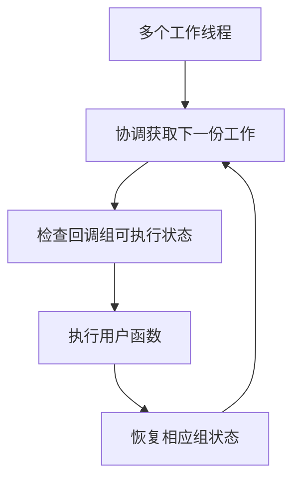

# 第 9 章 Executor 与 CallbackGroup

本章分析单线程、多线程执行器与回调组的并发约束，并用两个耗时定时器观察回调重叠。

本章承接[第 8 章](chapter-08-waitset-guard-timer.md)的就绪信息，重点解释工作选择、取出后的处理和回调组并发约束。publish/take 的底层接口与错误语义见第 6 章。

分析采用固定源码；实验待编译运行，时间线与结果为非实测预期。线程数、周期和吞吐量不构成实时保证。

## 9.1 执行器处理的是可执行工作

[`single_threaded_executor.cpp`](../../src/ros2/rclcpp/rclcpp/src/rclcpp/executors/single_threaded_executor.cpp) 在 spin 中不断取得下一份工作并执行。具体选择与类型分发位于 [`executor.cpp`](../../src/ros2/rclcpp/rclcpp/src/rclcpp/executor.cpp)。

本地普通路径在就绪集合中依次尝试定时器、订阅、服务、客户端和其他等待对象。不要把这段代码解释为一套可对所有执行器、内存策略与负载保证的全局固定优先级；它是当前路径的检查顺序。

`AnyExecutable` 保存本次选择的对象和回调组等信息。取出工作、执行工作和释放占用状态彼此衔接；没有选中工作时，执行器可以重新等待。

## 9.2 单线程执行器的边界

单线程 spin 在调用它的线程里处理普通回调。因此，同一个执行器里的耗时用户函数可以推迟其他回调。底层通信线程即便仍在接收，应用层也可能暂时无法处理样本。

这不是说整个进程只有一条线程。DDS、图监听或应用自己的线程仍可能存在。单线程执行器描述它的回调调度方式，而不是进程线程数量。

如果在回调里进行同步等待，而结果又需要该执行器执行其他回调才能提供，就可能形成无法推进的依赖。分析此类问题，需要画出等待关系，不能只靠增加话题深度修复。

## 9.3 多线程执行器不是取消所有约束

[`multi_threaded_executor.cpp`](../../src/ros2/rclcpp/rclcpp/src/rclcpp/executors/multi_threaded_executor.cpp) 创建工作线程，调用者线程也参与 `run()`。各线程在获取下一份工作时通过锁协调，再离开该临界区执行回调。



线程数决定执行资源数量，不保证同一节点中的所有回调一定并行。如果它们都在同一互斥组中，增加线程仍要遵守这个组的约束。

## 9.4 回调组描述允许的并发

[`callback_group.cpp`](../../src/ros2/rclcpp/rclcpp/src/rclcpp/callback_group.cpp) 和相关接口提供组状态。常用类型为 MutuallyExclusive 和 Reentrant：

| 分组 | 调度含义 |
| --- | --- |
| 同一个 MutuallyExclusive 组 | 不允许该组回调同时执行 |
| 不同 MutuallyExclusive 组 | 在资源和就绪条件满足时可并行 |
| Reentrant 组 | 不施加同组互斥约束，需要用户保证安全 |

NodeBase 创建默认互斥组。不显式设置回调组的订阅和定时器通常使用默认组；因此“节点加入多线程执行器”不自动改变默认组的行为。

Reentrant 允许重入，但不保证某个具体实体的回调必定重叠。实体自身状态、执行器选择和负载仍有约束。允许并发也不是共享数据已自动安全的证明。

## 9.5 回调组如何参与选择

本地 `get_next_ready_executable_from_map()` 在选出互斥组工作后，将 `can_be_taken_from` 状态设为 false，表示该组暂时占用。执行路径完成后恢复相关状态，并按需要通知。

这与等待集合中的就绪标志不是同一件事：某个实体可以已经就绪，但其回调组暂时不可执行。不能因此断言消息没到或定时器没到期。

组的自动加入选项还影响它如何与执行器关联。应用应持有自行创建的组，并避免把同一关联关系交给多个执行器。执行器取消后也要等待正在执行的回调结束，不能把 cancel 当成强制终止任意用户代码。

## 9.6 并发实验为什么要保护记录工具

本章程序通过原子计数记录同时运行的回调，用互斥锁保护整条日志输出。否则混杂日志和计数数据竞争可能让观察工具本身产生错误。

睡眠三百毫秒模拟耗时工作，不代表真实算法负载。定时器周期一百毫秒，明显短于工作时间，目的是使并发条件容易出现；不能把测到的次数直接推广为生产环境性能。

程序记录 begin/end、线程标识和最大同时运行数。不同线程 ID 不独立证明两个回调时间区间重叠；`max_active` 和成对日志提供更直接的证据。计数记录与日志取样并非完全相同的原子事件，不要将日志顺序解释成纳秒级精确调度。

## 9.7 实验准备与四种模式

探针见 [`experiments/scheduling/main.cpp`](../../experiments/scheduling/main.cpp)。两个定时器 A、B 每次工作约三百毫秒，程序约三秒后调用 cancel，再等待执行器和控制线程结束。正在执行的回调可能使实际总时长超过三秒。

在 Ubuntu、Bash 下，从书稿根目录构建：

```bash
source /opt/ros/humble/setup.bash
mkdir -p experiment-results
cmake -S experiments/scheduling -B build/scheduling -DCMAKE_BUILD_TYPE=Debug
cmake --build build/scheduling
```

需要 CMake、编译器、rclcpp 和可用 RMW。使用 apt 或本地环境的区别与前章相同，记录真实环境，不把源码推导写成实测。

### 实验一：单线程，同一互斥组

```bash
./build/scheduling/scheduling_probe single \
  | tee experiment-results/scheduling-single.txt
```

预期 `max_active=1`。A/B 可能因就绪与选择顺序出现不均衡，不能保证严格交替或调用次数完全相同。没有同时执行符合单线程约束。

### 实验二：两线程，同一互斥组

```bash
./build/scheduling/scheduling_probe shared \
  | tee experiment-results/scheduling-shared.txt
```

显式创建两线程执行器，但两定时器仍在同一互斥组。预期 `max_active=1`，即使日志中可能出现不同线程 ID，也不能据此称为重叠执行。这是线程资源与组约束的直接对照。

### 实验三：两线程，不同互斥组

```bash
./build/scheduling/scheduling_probe separate \
  | tee experiment-results/scheduling-separate.txt
```

预期容易观察到 A、B 工作区间重叠，`max_active` 达到 2。若没有达到，记录机器负载和实际日志，再分析是否出现同时就绪条件；允许并发不等于每次运行都保证相同轨迹。

### 实验四：两线程，可重入组

```bash
./build/scheduling/scheduling_probe reentrant \
  | tee experiment-results/scheduling-reentrant.txt
```

两定时器使用同一 Reentrant 组，预期也可能出现重叠。此实验只能说明组不施加同组互斥约束，不能证明同一订阅或同一定时器在所有情形下都重入。

正常退出为 0，异常为 2。若需要检查进程退出码，应启用 Bash `set -o pipefail`，避免只观察 tee 的状态。实验结束核对 begin/end 是否完整，并保留最终摘要；异常退出的日志不当作完整运行轨迹。

| 模式 | 预期最大重叠 | 实测状态 | 实际计数、线程与时长 |
| --- | --- | --- | --- |
| single | 1 | 待执行 | 待填写 |
| shared | 1 | 待执行 | 待填写 |
| separate | 可达到 2 | 待执行 | 待填写 |
| reentrant | 可达到 2 | 待执行 | 待填写 |

## 9.8 设计并发时先画依赖

把互不依赖的回调放到不同组，可以提供并发机会；共享可变对象仍需同步。把锁持有到同步等待结束，也可能造成另一回调无法取得锁而提供结果。

因此，应同时审视回调组约束、线程资源和应用锁及等待关系。修改为 Reentrant 并不自动消除死锁，还可能引入数据竞争。对长任务可以考虑拆分、异步完成或专门工作线程，但它们需要明确生命周期与结果交付方式。

## 9.9 本章小结

执行器选择并运行工作，回调组约束哪些工作可以同时执行。多线程提供资源，Reentrant 提供许可，共享数据安全和可推进性仍由应用设计承担。

下一章进入进程内通信与消息所有权，分析何时绕开普通中间件数据路径，以及消息如何在本地对象之间交付。本章已核验本地选择、工作线程和回调组状态入口，未编译运行实验，未给出硬实时或全局公平性保证。
