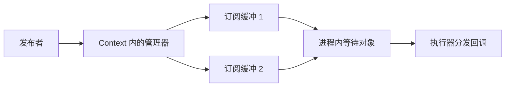

# 第 10 章 进程内通信与消息所有权

本章分析同进程中的消息交付与所有权，说明配置、输入形式、订阅者需求和其他端点如何影响复制与发布路径。范围为固定源码中的普通 ROS 消息，不展开 TypeAdapter。

实验待编译运行，地址与计数为非实测预期，不能据此证明零拷贝。

## 10.1 同一进程只是条件之一

同进程节点没有自动绕开中间件。NodeOptions 的 `use_intra_process_comms` 默认关闭，端点选项还可以覆盖节点默认值。[`resolve_use_intra_process.hpp`](../../src/ros2/rclcpp/rclcpp/include/rclcpp/detail/resolve_use_intra_process.hpp) 根据 Enable、Disable 或 NodeDefault 选择实际设置。

```cpp
rclcpp::NodeOptions options;
options.use_intra_process_comms(true);
```

它启用的是候选路径，不是对所有端点的零拷贝承诺。节点还要满足相关上下文、类型、名称和配置条件。两个节点如果使用不同 Context，也不能仅凭同进程推断它们共享同一个进程内管理器。

## 10.2 创建阶段的限制

[`publisher.hpp`](../../src/ros2/rclcpp/rclcpp/include/rclcpp/publisher.hpp) 的后初始化分支检查实际 QoS：要求 KeepLast、非零历史深度以及 Volatile。随后从 Context 获得 `IntraProcessManager`，登记发布者并保存其进程内标识。

[`subscription.hpp`](../../src/ros2/rclcpp/rclcpp/include/rclcpp/subscription.hpp) 在相应分支建立进程内订阅对象，并登记到 Context 的管理器。相关等待对象进入回调组，使执行器能够处理本地数据。

限制应以本地版本为准。不能因为别的发行版支持了某项组合，就把本书基线的异常分支省掉；也不能把进程内历史限制直接推广为全部 DDS 能力限制。

## 10.3 IntraProcessManager 连接端点与缓冲

[`intra_process_manager.hpp`](../../src/ros2/rclcpp/rclcpp/include/rclcpp/experimental/intra_process_manager.hpp) 为端点分配本地标识，管理匹配关系，并把数据交到订阅缓冲。订阅者可能请求共享访问，也可能请求独占所有权。



这里仍然存在缓冲与调度。发布者把对象交给本地机制，不意味着在 publish 内同步调用所有订阅回调。执行器和回调组的约束继续成立。

端点登记使用本地 ID，不能与 DDS 的发现身份混为一谈。管理器的匹配和普通 RMW 图信息协作，但并非同一份状态。

## 10.4 一个 unique_ptr 如何交给多个订阅者

普通 ROS 消息的独占指针重载，首先判断是否启用进程内机制。管理器根据订阅需求选择所有权传递、共享持有或复制。

| 订阅需求 | 可以出现的处理方式 |
| --- | --- |
| 单个需要独占的订阅者 | 把原对象所有权交给它 |
| 多个需要独占的订阅者 | 复制给部分订阅，原对象交给其中一个 |
| 可共享的订阅者 | 将所有权转为共享并交付相关缓冲 |
| 共享与独占混合 | 按对应分支共享、复制和转移 |

本地 `add_owned_msg_to_buffers()` 对除最后一个外的独占目标分配并复制消息，最后一个可以取得原对象。因此，多订阅者条件下不能仅凭传入 unique_ptr 就说没有复制。具体顺序也不是给某个用户节点的固定身份保证。

共享持有意味着多个消费者访问同一对象，不代表可以不受约束地并发修改。回调参数与自身数据安全要求仍应检查。

## 10.5 常量引用输入为什么会复制

同一发布者还接受 `publish(const MessageT &)`。没有进程内机制时，它进入普通发布路径；启用后，本地实现先 `duplicate_ros_message_as_unique_ptr()`，再交给独占指针重载。

这是因为调用者仍然拥有输入对象，客户端库需要另一个可在回调稍后执行时存活的对象。本地缓冲不能任意接管调用者栈变量的生命周期。

所以，启用机制与输入重载需要同时分析。常量引用、独占指针、借用消息和序列化消息不能用同一条“零拷贝”口号概括。

## 10.6 本地与远端订阅者可能同时存在

普通 ROS 消息 unique_ptr 路径比较订阅者总数与进程内订阅者数，以判断是否还需要中间件发布。需要同时服务其他端点时，先进行相应本地交付并获得共享对象，再进入普通发布路径。

因此，进程内通信并不要求进程完全与外部隔绝。它也不保证每次 publish 都只走本地分支。额外的 echo、录制或远端订阅者可能改变实际路径，性能实验中必须记录它们。

[`subscription_base.cpp`](../../src/ros2/rclcpp/rclcpp/src/rclcpp/subscription_base.cpp) 等接收路径会检查来自本地发布者的相关身份，以过滤本地交付情况下不应再次处理的副本。不要把两个底层入口都被调用直接解释为用户回调重复执行。

## 10.7 地址相同能说明什么

在一个进程里，记录发布前对象地址与回调对象地址，可以提供所有权传递的线索。单独的地址比较不能测出所有复制：字符串内部缓冲、类型转换、中间件编码和分配器地址复用都可能隐藏在观察之外。

不同进程的虚拟地址不能这样比较。即便数值相同，也不是同一个 C++ 对象。关闭进程内机制后，原对象被释放，后续分配也可能复用相同地址。

因此，本章实验把地址和源码路径一起使用，结论限定在本地对象交付。它不进行端到端零拷贝或性能宣称。

## 10.8 实验：输入重载和独占订阅者数量

探针见 [`experiments/ownership/main.cpp`](../../experiments/ownership/main.cpp)。同进程创建两个节点、一个发布者，以及一个或两个接受 UniquePtr 的订阅者。使用同一默认 Context、单线程执行器和十深度 QoS，等待发现后只发布一条消息。

Ubuntu、Bash 下，从书稿根目录执行：

```bash
source /opt/ros/humble/setup.bash
export ROS_DOMAIN_ID=42
export RMW_IMPLEMENTATION=rmw_fastrtps_cpp
mkdir -p experiment-results
cmake -S experiments/ownership -B build/ownership -DCMAKE_BUILD_TYPE=Debug
cmake --build build/ownership
```

需有编译器、CMake、rclcpp、std_msgs 和可用 RMW。apt 环境验证安装版本，本书对应实验需加载固定源码安装环境。实验期间不要运行其他 `/ownership` 订阅者。

### 实验一：启用与关闭

```bash
./build/ownership/ownership_probe on
./build/ownership/ownership_probe off
```

预期 on 收到一次回调，本地单独占交付可观察 `same_address=1`。off 同样可以通信，但经中间件路径；即使偶然地址相同，也不能认为发生了原对象直接交付。

两种模式正常收到目标数量退出为 0，超时为 1，异常或用法错误为 2。保存实际 original_address、回调地址和计数，禁止直接把示例地址写入日志。

### 实验二：两个独占订阅者

```bash
./build/ownership/ownership_probe two
```

预期收到两次回调。按本地管理器分支，其中一个取得原对象，另一个取得复制对象；记录实际地址与顺序，不预先给两个订阅者指定谁必须取得原对象。

若出现异常数量，先检查额外端点、时间期限和实际版本。计数为两次并不表示网络样本重复，它们属于两个不同的订阅实例。

### 实验三：常量引用输入

```bash
./build/ownership/ownership_probe reference
```

该模式启用本地机制，但调用 `publish(*msg)` 并保持原对象存活。预期接收对象不同于原对象，仍收到一次回调。这检验输入重载中的复制，而非否定进程内通信本身。

需要进一步证据时，用源码调试构建在 `duplicate_ros_message_as_unique_ptr`、`do_inter_process_publish` 或管理器交付语句设置断点，保存实际调用栈。模板符号可能需要按源文件行号定位，不能把未解析断点解释为路径未执行。

| 模式 | 状态 | 实际地址与数量 | 适用结论 |
| --- | --- | --- | --- |
| on / off | 待执行 | 待填写 | 待填写 |
| two | 待执行 | 待填写 | 待填写 |
| reference | 待执行 | 待填写 | 待填写 |

## 10.9 本章小结

进程内机制连接本地缓冲与执行器，通过消息所有权减少部分复制，但结果取决于输入形式和消费者需求。多个独占消费者、常量引用输入和外部订阅都可能改变复制与发布路径。

下一章研究另一种机制：由中间件借出消息内存。已核验本地选项解析、QoS 限制、管理器和发布分支，未构建运行实验；未展开 TypeAdapter 和完整复制统计。
