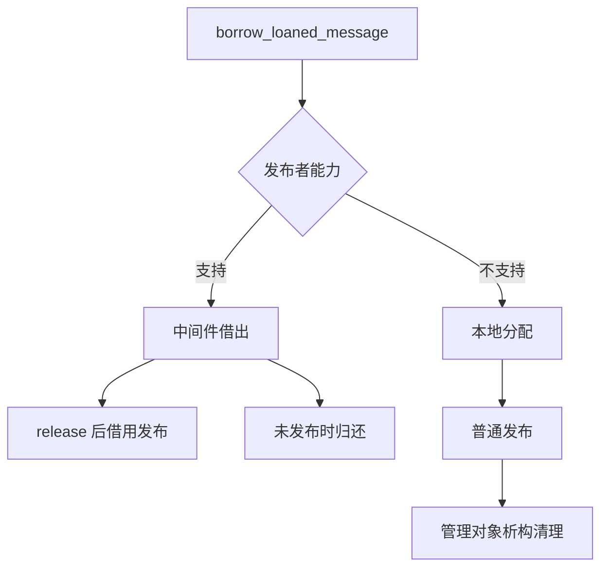

# 第 11 章 借用消息与内存管理

本章分析 LoanedMessage 的能力判断、借用、回退与归还，区分消息对象、字段容器和中间件缓冲的内存。

分析采用固定源码；实验待编译运行，尚无性能或端到端零拷贝实测结论。

## 11.1 借用的对象由谁负责

调用 `borrow_loaned_message()` 返回一个管理对象，应用通过 `get()` 访问消息。关键点不只是获得一个引用，而是借出后资源应通过哪个路径发布或归还。

| 资源来源 | 没有发布时 | 发布时 |
| --- | --- | --- |
| 中间件借出 | 返回对应中间件 | 转交借用发布路径 |
| 本地分配器回退 | 析构消息并释放本地内存 | 普通发布后由管理对象清理 |

用户不能随意 delete 一个由中间件借出的地址，也不能在归还后继续读取字段。发送返回与资源归还后对象的可访问性，均需要遵守接口生命周期。

## 11.2 borrow 成功不证明中间件借用成功

[`loaned_message.hpp`](../../src/ros2/rclcpp/rclcpp/include/rclcpp/loaned_message.hpp) 的构造函数先查询发布者能力。支持时调用 `rcl_borrow_loaned_message()`；不支持时使用本地分配器分配并构造 MessageT，还会提供相关日志。

因此，borrow 返回有效对象只说明当前取得了可用消息，不独立说明资源来自 DDS。必须同时记录 `can_loan_messages()` 与实际路径。

分配器回退让同一应用接口能够在不同实现上运行，但它不自动保持原来的性能特点。对象有字符串或动态序列时，构造及填写字段还可能涉及额外分配，不能只统计消息外壳的一次 allocate。

## 11.3 能力判断还取决于配置和类型

[`publisher_base.cpp`](../../src/ros2/rclcpp/rclcpp/src/rclcpp/publisher_base.cpp) 将能力查询转给 C 层。[`rcl/publisher.c`](../../src/ros2/rcl/rcl/src/rcl/publisher.c) 除了检查端点状态，还考虑禁止借用的环境配置，再读取 RMW 端点能力。

本地 [`rmw_fastrtps_cpp/src/publisher.cpp`](../../src/ros2/rmw_fastrtps/rmw_fastrtps_cpp/src/publisher.cpp) 的能力赋值涉及 data sharing 配置和类型支持的 `is_plain()` 判断。因此，“使用 Fast DDS”或“接口有界”都不足以独立保证可借用。

固定字段、固定大小、plain 类型、共享内存、data sharing 和 LoanedMessage 是相关但不同的概念。第 5 章的有界字符串仍有可变长度，不能因为存在上界就自动等同于 plain 类型。

设置 `ROS_DISABLE_LOANED_MESSAGES=1` 可以观察禁用路径。需要检查能力时可以显式设为 0，但这只是解除禁止条件，不会强制中间件支持某种类型。环境应在创建和使用端点前固定，不要在对象借出后修改能力配置。

## 11.4 发布与归还路径

[`publisher.hpp`](../../src/ros2/rclcpp/rclcpp/include/rclcpp/publisher.hpp) 的 LoanedMessage 重载先验证管理对象，且本地实现明确拒绝已启用进程内通信的借用消息发布。

支持借用时，它调用 `release()` 移交资源，再进入 `rcl_publish_loaned_message()` 等路径；不支持时，它调用普通中间件发布函数，不移交管理对象所有权。



这里有一个语义细节：支持分支 release 后管理对象变为无效；回退分支 publish 并没有将对象置空，它仍管理内存并等待析构。接口文档提醒发布后不再使用该消息，实验只打印管理状态，不再访问或再次发布其数据。

直接手工调用 `release()` 后，如果拿到的是中间件资源，生成的指针包装不负责普通 delete；未发布时还需要正确归还。应用通常应保留 RAII 接口，避免自行拼接底层资源处理。

## 11.5 RAII 的未发布归还

LoanedMessage 析构时，若仍持有有效消息，支持借用的分支调用 `rcl_return_loaned_message_from_publisher()`，回退分支则析构消息并释放本地内存。

它保存发布者引用，因此发布者必须在借用对象之前保持存活；不能把借用对象任意保存到发布者已经销毁的作用域。异常退出、未发布和正常发布都应结合这条依赖检查。

[`rmw_fastrtps_shared_cpp/src/rmw_publisher.cpp`](../../src/ros2/rmw_fastrtps/rmw_fastrtps_shared_cpp/src/rmw_publisher.cpp) 的借出与归还分别连接数据写入器的 loan_sample 和 discard_loan 等操作。[`rmw_publish.cpp`](../../src/ros2/rmw_fastrtps/rmw_fastrtps_shared_cpp/src/rmw_publish.cpp) 实现对应借用发布入口。它们不是本地进程内管理器的缓冲交付。

## 11.6 接收端与内存策略

[`executor.cpp`](../../src/ros2/rclcpp/rclcpp/src/rclcpp/executor.cpp) 的订阅执行分支区分序列化、借用和普通消息。借用分支通过 C 接口取出借用地址，处理之后归还；普通分支从订阅的消息内存策略取得对象。

默认 [`message_memory_strategy.hpp`](../../src/ros2/rclcpp/rclcpp/include/rclcpp/message_memory_strategy.hpp) 使用 allocate_shared 等方法创建消息，并以共享引用管理释放。名字中的 borrow_message 是策略借出，不等于 DDS 借用接口。

同时，[`subscription_base.cpp`](../../src/ros2/rclcpp/rclcpp/src/rclcpp/subscription_base.cpp) 在能力检查中有针对接收借用风险的提示。应用回调若保存指向稍后归还资源的引用，可能超出有效期；不能单凭共享指针形式推断它延长了所有底层资源的生命周期。

实验仅验证发布侧能力和资源路径，不启用接收借用，也不据发布侧能力推断接收侧行为。

## 11.7 性能结论需要分项测量

应分别统计消息对象与字段分配、应用到中间件的复制、序列化开销、实际传输方式、回调调度与尾延迟。借用成功不等于没有序列化，进程内交付也不等于没有容器复制。

可比较普通引用、独占指针和借用接口，但需固定消息尺寸、RMW 配置、订阅者数量、进程布局和负载。日志输出本身会改变时延，本章探针不作为性能基准。

## 11.8 实验：能力、回退与未发布归还

程序见 [`experiments/loaning/main.cpp`](../../experiments/loaning/main.cpp)。分别创建 UInt32 和 String 发布者，打印能力，借出一条未发布消息并退出其作用域，再借出另一条并发布。程序不创建订阅者，因此不能验证远端收到数据。

Ubuntu、Bash 下从书稿根目录执行：

```bash
source /opt/ros/humble/setup.bash
export ROS_DOMAIN_ID=42
export RMW_IMPLEMENTATION=rmw_fastrtps_cpp
mkdir -p experiment-results
cmake -S experiments/loaning -B build/loaning -DCMAKE_BUILD_TYPE=Debug
cmake --build build/loaning
```

前提是具备编译器、CMake、rclcpp、std_msgs 和所选实现。使用固定源码环境核验本书行为，apt 的配置和能力可能不同。

### 实验一：显式禁用，确认回退

```bash
ROS_DISABLE_LOANED_MESSAGES=1 ./build/loaning/loaning_probe plain
ROS_DISABLE_LOANED_MESSAGES=1 ./build/loaning/loaning_probe string
```

按本地实现，预期 `can_loan=0`，未发布借用对象有效且作用域结束，第二个对象有效并通过普通发布返回。回退分支的 `after_publish_valid` 可以仍为 1；这不许可继续访问已发布消息数据，只说明仍有本地管理状态等待析构。

### 实验二：解除禁止，检查真实能力

```bash
ROS_DISABLE_LOANED_MESSAGES=0 ./build/loaning/loaning_probe plain
ROS_DISABLE_LOANED_MESSAGES=0 ./build/loaning/loaning_probe string
```

不预设一定 `can_loan=1`。UInt32 可以作为固定字段候选，仍取决于实际类型支持和 data sharing 等配置；String 的动态字段还会影响能力。记录实际结果，不把两个类型在本机的一次行为推广到所有实现。

若能力为真，按本地支持分支，发布后 release 使 `after_publish_valid=0`；能力为假则回退。正常发布返回时退出为 0，异常为 2；没有接收者，不能把退出码当成通信完整性证明。

### 实验三：核对未发布资源归还

用 GDB 启动 plain 模式，设置 `rcl_borrow_loaned_message`、`rcl_return_loaned_message_from_publisher`、`rcl_publish_loaned_message` 和 `rcl_publish` 函数断点，运行后保存命中的调用栈。

能力为真时，第一条未发布对象应走归还入口，第二条发布对象走借用发布；能力为假时，不要求命中这些借用 C 接口，应核对本地分配与普通发布分支。模板及析构源码行观察需要匹配的调试信息。

不直接调用 release，不制造泄漏来测试资源池，也不把日志中的“作用域结束”代替归还函数证据。能力随运行环境变化时，保留真实断点结果和环境记录。

| 实验 | 状态 | 实际能力与管理状态 | 路径证据与限制 |
| --- | --- | --- | --- |
| 禁用与回退 | 待执行 | 待填写 | 待填写 |
| 类型与能力 | 待执行 | 待填写 | 待填写 |
| 未发布归还 | 待执行 | 待填写 | 待填写 |

## 11.9 本章小结

借用消息提供资源管理接口，但资源既可能来自中间件，也可能来自本地回退。正确解释行为，需要同时检查能力、类型、环境、发布分支和归还时机。

下一章进入 Service 与 Client，研究请求响应、Future 和执行器怎样协作。本章已核验发布侧借用、回退、归还以及接收和内存策略入口，未编译运行探针，未给出零拷贝或性能实测结论。
